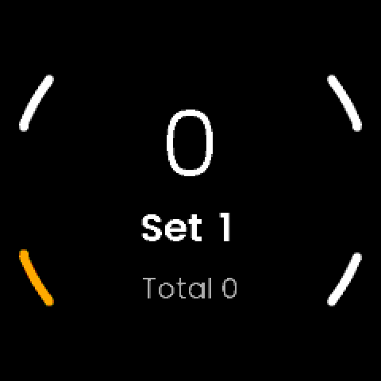
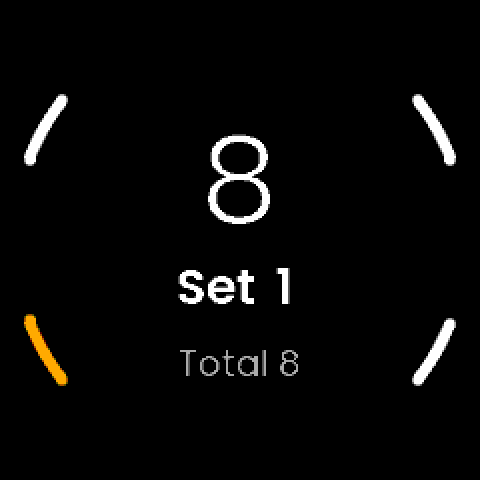
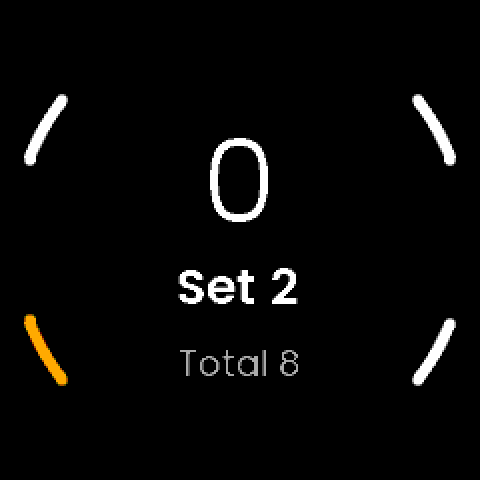

# Knitting: notes

An on-watch knitting counter: press a button for every row, group rows into
sets ("8 rows, 4 times"), and see the rows in this set, which set you are on
and the total. Independent of the other apps. Not an activity: no GPS, no FIT
files, nothing syncs to UNA or Strava.
Started from the SDK's Waypoint tutorial (LVGL), through X Weigh-in's layout.

## Why this app (15 October 2026)

Jon asked for a knitting row tracker, "a reps and sets counter, but rows and
sets". The display shows the rows in the current set, the set number and the
total in smaller text. Buttons: count row, count set, reset.

## Decisions

Planned with Jon on 15 October 2026 (plan approved; the reset question below
was put in the plan and is still open for him to change):

- **Name: Knitting** (Jon, 15 October 2026; the plan had called it X Rows).
  Folder `knitting/`, `Knitting` on the watch (7 bytes), tags `knitting-vX.Y.Z`.
  The development APP_ID was re-derived from the new name; nothing had been
  installed under the old one.
- **Buttons:**

  | Button | Action |
  |---|---|
  | R1 (select) | Count a row |
  | L1 | Start the next set |
  | L2 | Reset (K0: immediate; K2: hold to confirm) |
  | R2 | Back / exit |

- **Planned for K2:** the count saved on every press, hold-R1 to undo a
  mis-tap, hold-L2 to reset. The SDK has no long-press code; a screen derives
  it from the press and release codes with its own timing
  (`SDK/GUI/Button.hpp`), so this is possible.
- **Planned for K3:** phone settings for an optional rows-per-set and
  sets target, a buzz when a set completes, and auto-advance. 0 means off, so
  the app stays a free counter.
- **Later, if wanted:** several projects, rows per hour, a history CSV.

## What the platform gives us (15 October 2026)

- Four buttons, each with click, press and release codes
  (`Libs/Header/SDK/GUI/Button.hpp`). R2 is BACK.
- The service outlives the GUI unless it chooses to exit
  (`Docs/service-lifecycle.md`); the backlight is a timed pulse, so the screen
  dims between rows. Whether the screen is readable when it wakes is a Gate K0
  question.
- Phone settings are config fields (`Docs/app-config-fields.md`); a buzzer
  and vibration request exist (`CommandMessages.hpp`).
- `Apps/SharedData/` is the shared folder that survives an uninstall
  (X Weigh-in NOTES).

## Phases

| Phase | Work | Gate |
|---|---|---|
| **K0** | Identity, scaffold, CI build; one screen that counts rows, sets and a reset, in memory | K0: do the four buttons feel right, is the screen readable while knitting? |
| K1 | The core, pure and host-tested: counter, undo, targets, store, text | Host tests pass; file layout agreed |
| K2 | The real screen: next-set feedback, reset with confirm, hold-to-undo, resume from file, buzz | A real knitting session |
| K3 | Phone settings | Settings reach the watch over USB |
| K4 | A glance, a second `.uapp` | Glance on the watch |
| K5 | First store release, 1.0.0 | Installed from the store |

## K0: identity, layout and the first look (15 October 2026)

- **Identity:** `Knitting`, type `Utility`, "Knitting" on the watch. Development
  APP_ID `E7D056DCC90561F1`, the first 16 hex of md5("Knitting") (as Streak, Run
  and Weigh-in started). The portal issues the store ID at K5.
  Version from `knitting-v*` tags (`Software/cmake/knitting-version.cmake`).
  Icon: `Resources/make_icons.py`, lime needles over a white ball of yarn.
- **Layout (as X Weigh-in):**
  - `Software/Libs/Core`: pure C++, header-only where the GUI uses it. For K0,
    `RowCounter.hpp`: rows, set (from 1), total.
  - `Software/Libs/App`: the service and the fixed-size messages
    (`Commands.hpp`).
  - `Software/Apps/LVGL-GUI`: the screen and the simulator.
  - `Software/Apps/Knitting-CMake`: the watch build.
  - No `assets.json`, as X Weigh-in: its font paths point into the TouchGFX GUI.
    The generated font `.c` files (Poppins Light 60 digits only, Semibold
    40/25/20, Regular 18/14) are copies of X Weigh-in's.
- **The counter lives in the service**, and the GUI sends `COUNT_ROW`,
  `NEXT_SET` and `RESET_ALL`; the service answers with one `COUNTER_UPDATE`
  of three integers. K2's saved file then needs no change to the GUI.
- **Counter rules (RowCounter, 8 host tests):**
  - **Next set on an empty set does nothing.** A double press must not leave
    a run of empty sets. Jon can ask for the opposite.
  - **Counters saturate, never wrap:** 999 rows in a set, 999 sets, 99,999
    rows in total. Those are the most the display's digits hold. A stuck
    button can therefore never show a smaller number.
  - A state read from a file is clamped (for K2's reader).
- **Not in K0:** nothing is saved. The service exits when the GUI closes
  (Waypoint's pattern), so the count is lost when you leave the app. That is
  why K2 comes before anyone knits a real project with it.
- **The screen:** the rows in the set in Light 60, "Set N" in Semibold 25,
  "Total N" in grey Regular 18. L2 (reset) is amber, the others white.

### K0 verified (15 October 2026)

- **Host tests:** 8 pass: eight rows four times (total 32); next set on an
  empty set and on a double press; reset; the three saturation limits; a
  clamped state from a file.
- **Simulator** (`docs/experiments/capture_screens.sh`): 8 rows on R1, L1 gives
  Set 2 with 0 rows, a second L1 changes nothing, 3 more rows give Total 11,
  L2 resets to Set 1, R2 exits.
- **Watch target, local compile check:** Ubuntu's `arm-none-eabi-gcc` with
  Race's syscall stubs (rebuilt with `-mcpu=cortex-m33 -mfpu=fpv5-sp-d16
  -mfloat-abi=hard -mthumb`, or the link fails on architecture mismatch) and
  `pyelftools` for the SDK's post-link step. `Knitting_0.0.0-dev.uapp`, 181,296
  bytes, no warnings from our code. **Not installable**; the watch copy comes
  from CI.
- **Not verified:** nothing has run on a watch yet. CI has not run on this
  branch.

## Gate K0: what Jon tests on the watch

1. **Install.**
   - On GitHub, Actions, take the newest green **Watch builds** run on the
     branch `claude/knitting` and download **watch-apps**.
   - Over USB, create `Apps/Knitting/` on the watch and copy `Knitting_*.uapp` into it.
   - Eject safely, then power-cycle the watch (as for the other apps).
2. **Open Knitting and knit with it for a few rows.** Check:
   - R1 counts a row, L1 starts the next set, L2 resets, R2 exits.
   - **Can you press R1 without looking, and without pressing anything else?**
     If another button is easier to hit, the mapping changes.
   - **Does the screen stay readable?** When the backlight pulses off between
     rows, does a press wake it and count at once, or only wake it?
   - Is the number big enough at arm's length? Is "Total" worth its space?
3. **Close and reopen the app.** The count starts again from 0; that is
   expected in K0.

What the answers decide:
- **If a press only wakes the screen:** the first press after a dim needs a
  rule, which changes K2.
- **If R1 is hard to hit blind:** the button mapping is revisited before K1.
