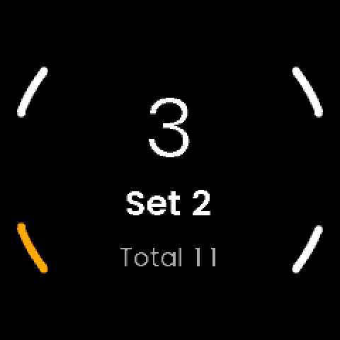

# Knitting: notes

An on-watch knitting counter: press a button for every row, group rows into
sets ("8 rows, 4 times"), and see the rows in this set, which set you are on
and the total. Independent of the other apps. Not an activity: no GPS, no FIT
files, nothing syncs to UNA or Strava.
Started from the SDK's Waypoint tutorial (LVGL), through X Weigh-in's layout.

## Why this app (15 October 2026)

Jon asked for a knitting row tracker, "a reps and sets counter, but rows and
sets". The display shows the rows in the current set, the set number and the
total in smaller text. Buttons: count row, count set, reset.

## Decisions

Planned with Jon on 15 October 2026 (plan approved; the reset question below
was put in the plan and is still open for him to change):

- **Name: Knitting** (Jon, 15 October 2026; the plan had called it X Rows).
  Folder `knitting/`, `Knitting` on the watch (7 bytes), tags `knitting-vX.Y.Z`.
  The development APP_ID was re-derived from the new name; nothing had been
  installed under the old one.
- **Buttons:**

  | Button | Action |
  |---|---|
  | R1 (select) | Count a row |
  | L1 | Start the next set |
  | L2 | Reset (K0: immediate; K2: hold to confirm) |
  | R2 | Back / exit |

- **Planned for K2:** the count saved on every press, hold-R1 to undo a
  mis-tap, hold-L2 to reset. The SDK has no long-press code; a screen derives
  it from the press and release codes with its own timing
  (`SDK/GUI/Button.hpp`), so this is possible.
- **Planned for K3:** phone settings for an optional rows-per-set and
  sets target, a buzz when a set completes, and auto-advance. 0 means off, so
  the app stays a free counter.
- **Later, if wanted:** several projects, rows per hour, a history CSV.

## What the platform gives us (15 October 2026)

- Four buttons, each with click, press and release codes
  (`Libs/Header/SDK/GUI/Button.hpp`). R2 is BACK.
- The service outlives the GUI unless it chooses to exit
  (`Docs/service-lifecycle.md`); the backlight is a timed pulse, so the screen
  dims between rows. Whether the screen is readable when it wakes is a Gate K0
  question.
- Phone settings are config fields (`Docs/app-config-fields.md`); a buzzer
  and vibration request exist (`CommandMessages.hpp`).
- `Apps/SharedData/` is the shared folder that survives an uninstall
  (X Weigh-in NOTES).

## Phases

| Phase | Work | Gate |
|---|---|---|
| **K0** | Identity, scaffold, CI build; one screen that counts rows, sets and a reset, in memory | K0: do the four buttons feel right, is the screen readable while knitting? |
| K1 | The core, pure and host-tested: counter, store, text. **Done so far: the saved count** (below). Still to come here: undo, targets | Host tests pass; the count survives a close and a power cycle |
| K2 | The real screen: next-set feedback, reset with confirm, hold-to-undo, resume from file, buzz | A real knitting session |
| K3 | Phone settings | Settings reach the watch over USB |
| K4 | A glance, a second `.uapp` | Glance on the watch |
| K5 | First store release, 1.0.0 | Installed from the store |

## K0: identity, layout and the first look (15 October 2026)

- **Identity:** `Knitting`, type `Utility`, "Knitting" on the watch. Development
  APP_ID `E7D056DCC90561F1`, the first 16 hex of md5("Knitting") (as Streak, Run
  and Weigh-in started). The portal issues the store ID at K5.
  Version from `knitting-v*` tags (`Software/cmake/knitting-version.cmake`).
  Icon: `Resources/make_icons.py`, lime needles over a white ball of yarn.
- **Layout (as X Weigh-in):**
  - `Software/Libs/Core`: pure C++, header-only where the GUI uses it. For K0,
    `RowCounter.hpp`: rows, set (from 1), total.
  - `Software/Libs/App`: the service and the fixed-size messages
    (`Commands.hpp`).
  - `Software/Apps/LVGL-GUI`: the screen and the simulator.
  - `Software/Apps/Knitting-CMake`: the watch build.
  - No `assets.json`, as X Weigh-in: its font paths point into the TouchGFX GUI.
    The generated font `.c` files (Poppins Light 60 digits only, Semibold
    40/25/20, Regular 18/14) are copies of X Weigh-in's.
- **The counter lives in the service**, and the GUI sends `COUNT_ROW`,
  `NEXT_SET` and `RESET_ALL`; the service answers with one `COUNTER_UPDATE`
  of three integers. K2's saved file then needs no change to the GUI.
- **Counter rules (RowCounter, 8 host tests):**
  - **Next set on an empty set does nothing.** A double press must not leave
    a run of empty sets. Jon can ask for the opposite.
  - **Counters saturate, never wrap:** 999 rows in a set, 999 sets, 99,999
    rows in total. Those are the most the display's digits hold. A stuck
    button can therefore never show a smaller number.
  - A state read from a file is clamped (for K2's reader).
- **Not in K0:** nothing is saved. The service exits when the GUI closes
  (Waypoint's pattern), so the count is lost when you leave the app. That is
  why K2 comes before anyone knits a real project with it.
- **The screen:** the rows in the set in Light 60, "Set N" in Semibold 25,
  "Total N" in grey Regular 18. L2 (reset) is amber, the others white.


### K0 verified (15 October 2026)

- **Host tests:** 8 pass: eight rows four times (total 32); next set on an
  empty set and on a double press; reset; the three saturation limits; a
  clamped state from a file.
- **Simulator** (`docs/experiments/capture_screens.sh`): 8 rows on R1, L1 gives
  Set 2 with 0 rows, a second L1 changes nothing, 3 more rows give Total 11,
  L2 resets to Set 1, R2 exits.
- **Watch target, local compile check:** Ubuntu's `arm-none-eabi-gcc` with
  Race's syscall stubs (rebuilt with `-mcpu=cortex-m33 -mfpu=fpv5-sp-d16
  -mfloat-abi=hard -mthumb`, or the link fails on architecture mismatch) and
  `pyelftools` for the SDK's post-link step. `Knitting_0.0.0-dev.uapp`, 181,296
  bytes, no warnings from our code. **Not installable**; the watch copy comes
  from CI.
- **Not verified:** nothing has run on a watch yet. CI has not run on this
  branch.

## Gate K0: what Jon tests on the watch

1. **Install.**
   - On GitHub, Actions, take the newest green **Watch builds** run on the
     branch `claude/knitting` and download **watch-apps**.
   - Over USB, create `Apps/Knitting/` on the watch and copy `Knitting_*.uapp` into it.
   - Eject safely, then power-cycle the watch (as for the other apps).
2. **Open Knitting and knit with it for a few rows.** Check:
   - R1 counts a row, L1 starts the next set, L2 resets, R2 exits.
   - **Can you press R1 without looking, and without pressing anything else?**
     If another button is easier to hit, the mapping changes.
   - **Does the screen stay readable?** When the backlight pulses off between
     rows, does a press wake it and count at once, or only wake it?
   - Is the number big enough at arm's length? Is "Total" worth its space?
3. **Close and reopen the app.** The count starts again from 0; that is
   expected in K0.

What the answers decide:
- **If a press only wakes the screen:** the first press after a dim needs a
  rule, which changes K2.
- **If R1 is hard to hit blind:** the button mapping is revisited before K1.

## K1 (part): the count is remembered (15 October 2026)

Jon, after K0 worked on the watch: closing the app lost the numbers. Now the
app reopens exactly where it was.

- **The file:** `Apps/Knitting/state.txt`, plain text, readable over USB:

  ```
  knitting 1
  rows=8
  set=2
  total=16
  ```

- **Saved after every change** (a row, a next set, a reset that changed anything).
  The service sends the new numbers to the screen first and writes second, so a
  slow flash write never delays what you see. A failed write is logged and
  ignored; the next change tries again.
- **Loaded once, when the service starts.** Order: `state.txt`, then
  `state.txt.bak`, then a fresh counter at set 1. The service still exits when
  the screen closes; nothing is lost by that, as everything was saved when it
  changed.
- **Crash-safe:** the write goes through `SafeFile`, a copy of HybridX Streak's
  and Run's (write `state.txt.tmp`, flush, keep the old file as `.bak`, rename
  into place). A reset or a flat battery at any point leaves the new file or the
  previous one. So no checksum is needed in the file itself.
- **Strict reader:** exactly the version line and the three keys, in order, digits
  only, a final newline. Anything else (a torn file, CRLF from a hand edit, a
  negative number, another version) counts as unusable and falls back. A number
  that parses but is out of range is pulled inside the limits, so a hand-edited
  `rows=123456` opens as 999.
- **Not saved:** nothing else is state yet. There is no copy in `SharedData`, so
  uninstalling the app (which deletes its folder) loses the count; updating by
  copying a new `.uapp` over the old one does not touch the file. A copy can be
  added as Weigh-in has if wanted.
- **New files:** `Core/Header/{SafeFile,StateCodec,StateStore}.hpp` and their
  sources; `RowCounter::reset()` now says whether it changed anything, so a
  reset on a fresh counter does not write.

### K1 (part) verified (15 October 2026)

- **Host tests:** 24 pass (was 8). New: the codec's layout, round trip at the
  start and the limits, the buffer-size edge, 12 kinds of bad file, every
  truncation of a good file, clamping; the store's save and load, the latest
  save wins, a corrupt or missing file falls back to the backup, both bad gives a
  fresh counter, a failed save keeps the old copy.
- **Simulator** (`docs/experiments/resume_check.sh`): 8 rows, next set, 3 rows,
  R2; reopen shows 3 rows, Set 2, Total 11. Reset, R2, reopen shows 0, Set 1,
  Total 0. A damaged `state.txt` beside a good `.bak` opens from the backup (2 rows,
  Total 3), with a warning in the log.
- **Watch target, local compile check:** `Knitting_0.0.0-dev.uapp`, 183,040 bytes
  (181,296 before), no warnings from our code. **Not installable**; the watch copy
  comes from CI.
- **Not verified:** nothing has run on a watch yet. The simulator's mock file
  system is a folder on the PC, not the watch's FAT volume.




### Gate K1 (saved count): what Jon tests on the watch

1. **Install** the new CI build as before: replace `Knitting_0.0.0-dev.uapp` in
   `Apps/Knitting/`, eject safely, power-cycle.
2. **Count** a few rows, start a second set, count two more. Note the numbers.
3. **Press R2 to close the app, then open it again.** The same numbers should show.
4. **Power-cycle the watch** (hold power, off, on) and open it again: the same numbers.
5. **Over USB, open `Apps/Knitting/state.txt`.** It should show the same three numbers.
6. **L2 (reset)** still resets at once, and now wipes the saved count too. Reopen to
   see that a reset one is remembered as 0.

What the answers decide:
- **If the numbers come back after 3 but not after 4:** the write is not
  reaching the flash before power-off; the save moves earlier or flushes more.
- **If a press feels slower than in K0:** the write is in the way; it moves to a
  quieter moment.
- **Reset is easy to hit by accident**, and now costs the saved count: the
  hold-to-confirm in the plan (K2) comes next.
