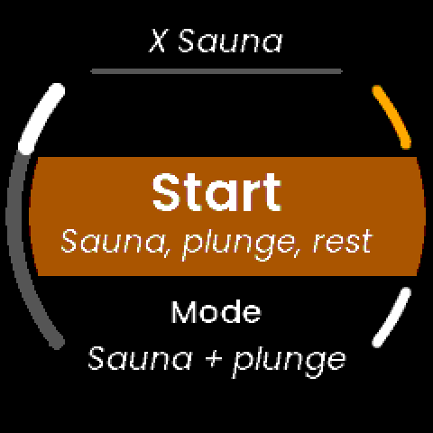
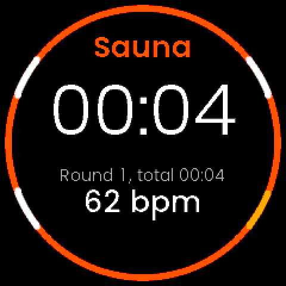
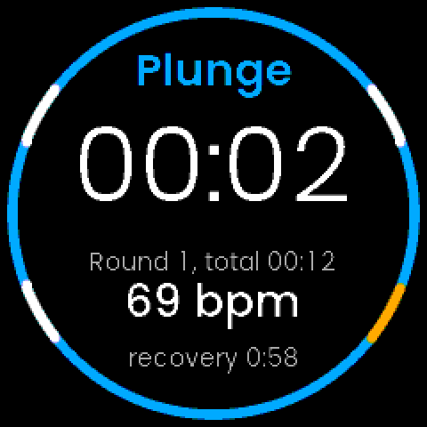
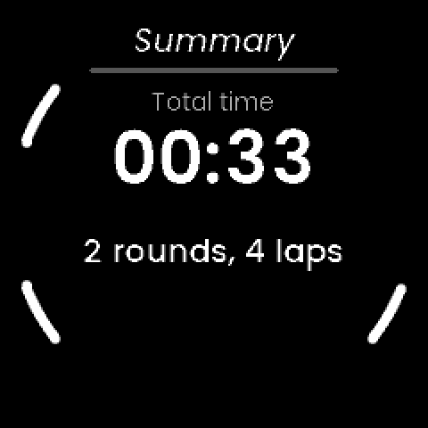
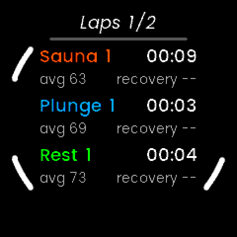

# X Sauna: notes

An on-watch sauna and cold-plunge tracker. Start a session as **Sauna → Cold
plunge** or **Just sauna**, press a lap button to swap phase, and record time,
heart rate and temperature. Based on a workout: the session becomes an activity
(a FIT file that syncs to UNA and on to Strava), not a utility. Independent of
the other apps.
Started from Knitting's layout (itself from the SDK's Waypoint tutorial, LVGL).

## Why this app (20 October 2026)

Jon's request: "a sauna tracking app, probably based on workout. Two options:
Sauna → Cold plunge, or Just sauna. Lap buttons to swap. Time, heart rate and
temperature recording." He asked for further ideas; of those offered he chose
**HR recovery** and a **Rest phase**.

## Decisions

Planned with Jon on 20 October 2026 (plan approved for SA0 only):

- **Name: X Sauna** (working name; Jon can change it, as Knitting's changed).
  Folder `x-sauna/`, `X Sauna` on the watch (7 bytes), `XSauna` as the build and
  file name, tags `sauna-vX.Y.Z`. The development APP_ID is the first 16 hex of
  md5("XSauna"), `400AE282F6C2C161`, the convention Knitting and X Weigh-in
  followed (checked: md5("XWeighIn") gives their development ID). The portal
  issues the real one at SA4.
- **In the first version:** the two session types and the lap swap; time, heart
  rate and temperature recorded to a FIT file; **HR recovery** (how far heart
  rate falls in the minute after a phase change); an optional **Rest phase**
  (Sauna → Plunge → Rest → ...).
- **Offered and not chosen:** target times with a buzz and a heart-rate ceiling
  from the phone settings; a typed-in sauna temperature. The second comes back
  at Gate 0 if the sensor turns out to be no use in the heat (below).
- **Gate SA0 result (Jon, 21 October 2026, after asking UNA and testing):** the
  temperature reads **well above room temperature but below body temperature**:
  a temperature inside the watch, with a long lag, not the air. **Decision: use
  it only as a rough guide** to sauna versus ambient versus cold plunge, never
  as a monitored temperature. Nothing in the app presents it as degrees. The
  test was room and wrist only; there is **no sauna or plunge data yet**, so no
  threshold is set from evidence (see SA1).
- **Open for Jon:** whether the watch is rated for a sauna and for water (below).
  Nothing in the SDK says either way.

## What the platform gives us (20 October 2026)

- **Heart rate:** `HEART_RATE` (bpm and a trust level) and `HEART_RATE_EX` exist.
  HybridX Race already records HR a second into a FIT file with laps, developer
  fields and crash recovery (`hybridx-race/Software/Libs/Header/ActivityWriter.hpp`).
- **Temperature: the risk.** `SDK::Sensor::Type::AMBIENT_TEMPERATURE` (0x70),
  parser `SensorDataParserTemperature.hpp`: one float, "°C (or device-specific
  units)", `-273.15` when invalid. `Docs/SensorsLayer.md` marks it `TEMP (float
  °C?)`. Nothing says whether it is the air around the watch or a body or board
  reading, how quickly it responds, or where it tops out. HybridX Race's
  `ROADMAP.md` section 2 reached the same point and never connected it. Sauna
  air is typically 80 to 100 degrees, far beyond what a wearable is designed for.
- **The simulator cannot supply it.** `Docs/Simulator.md` lists GPS, heart rate,
  battery, pressure, the IMU and steps. The service makes a reading up under
  `SIMULATOR` (`Core/Header/SimTemp.hpp`) and the screen says "made up".
- **FIT:** `FitProfile.hpp` has no temperature field on `Record`. The public
  profile has `Record.temperature` as field 13, `sint8`, whole degrees C (from
  Race ROADMAP 2.2: **not yet checked by a decode round trip**, which is SA2's
  job). No sauna sport is known; the safe default is `training`/`generic`, as
  Race's NOTES 5.12 settled (Garmin ignored the other sub-sport candidates). Never
  invent FIT numbers: look one up in the profile tables and decode it back.
- **Buttons:** four. R2 is back. A long press has to be derived from press and
  release codes (`HoldTimer.hpp` in Knitting). The GUI runs at 10 frames a second;
  the face is round.
- **Streak interplay:** ~~HybridX Streak counts every activity the watch records,
  so a sauna session will count towards the streak once it is an activity.~~
  **Not so (27 October 2026).** On a watch, Streak cannot read other apps' `Activity/`
  folders. It sees only the apps that write a HybridX activity-link summary
  (`hybridx-link/docs/ACTIVITY_LINK.md`). Jon decided that X Sauna stays out of the
  shared data and the streak count, so a sauna session does not count, and Sauna
  writes no link file.
- **Appending to a file that already exists works on the watch** (X Weigh-in W2),
  which the probe's log relies on.

## Phases

| Phase | Work | Gate |
|---|---|---|
| **SA0** | Identity, scaffold, CI build, and a **probe screen** that logs temperature and heart rate once a second to a CSV | Jon runs the staged test and sends the CSV: is the sensor there, what unit, ambient or skin, how it behaves when hot, wet or cold |
| SA1 | The pure core with an injected clock, host-tested: session model, phases, laps, HR recovery, heat hint, text. **Done (22 October 2026)** | Host tests pass; Just-sauna rule settled |
| SA2 | The service and the FIT file: HR and temperature a second, laps with developer fields, crash recovery; APP_TYPE moves to Activity. **Done (22 October 2026)**, on branch `claude/x-sauna-sa2` | A FIT file decodes (done here); the UNA app, Garmin and Strava take it (Jon) |
| SA3 | The LVGL screens: start, live, summary. **Done (22 October 2026)**, on branch `claude/x-sauna-sa3` | Jon uses it on the wrist in a real session |
| SA4 | Store release: icon, package, `SUBMISSION.md`, 1.0.0 | Installed from the store |

Outline of later phases (refined at each gate):

- **SA1:** `SessionModel` with an injected clock and unsigned deltas for the
  wrapping millisecond clock; modes Sauna+Plunge and Just sauna, optional Rest;
  per-phase laps with HR average and maximum and temperature average and
  maximum; HR recovery as the drop from the heart rate at the end of a phase to
  the heart rate 60 s later, "no result" when HR is missing; integer formatting.
- **SA2:** a trimmed copy of Race's `ActivityWriter` (Race's carries race-specific
  fields; the apps stay independent). HR and temperature per record, laps with
  developer fields for phase type, round and HR recovery. Fixed-size messages.
- **SA3:** R1 swaps phase (the main action); L1 pause and resume; a way to
  insert Rest; R2 exits with a hold-to-stop confirm. Final map to match Race's
  conventions once read. Phase colours: sauna warm, plunge cool, rest neutral.
  The summary shows rounds, time in each phase, peak temperature, peak HR and
  best recovery.

## SA0: the heat probe (20 October 2026)

> **Superseded by SA2 on the `claude/x-sauna-sa2` branch**, which replaces the
> probe with the real service. The probe build stays on `claude/x-sauna-sa0`
> (Jon is testing it in a real sauna). This section and the next two describe it.


### Layout

- `Software/Libs/Core` (pure C++, host-tested; header-only where the GUI uses it):
  - `FixedPoint.hpp`: a float as hundredths and back to text, with no `%f`;
  - `ProbeStats.hpp`: last, lowest, highest, count and the gaps between samples
    (the sensor's own timestamps, unsigned differences);
  - `ProbeSnapshot.hpp`: the readings as the screen shows them;
  - `ProbeCsv.hpp` and `Sources/ProbeCsv.cpp`: the log's lines, and a counter
    for the "# run" lines so each run can be numbered;
  - `SimTemp.hpp`: the made-up temperature for the simulator.
- `Software/Libs/App`: `Service` (sensors, log, messages) and `Commands.hpp`
  (one Service → GUI message, two GUI → Service; the update is 96 bytes on a
  64-bit host, less on the watch, and has a `static_assert` against the 256-byte
  pool block).
- `Software/Apps/LVGL-GUI`: `ProbeScreen`, the model, the simulator.
  Fonts are Knitting's generated Poppins files, unchanged.
- `Software/Apps/Sauna-CMake`: the watch build. `APP_TYPE` is `Utility` for now.
- `Resources/make_icons.py`: a placeholder icon (steam over hot stones).
- CI: `watch-builds.yml` builds it (`sauna`), collects the `.uapp`, and runs the
  host tests.

### What the probe does

It connects `AMBIENT_TEMPERATURE` and `HEART_RATE` at their default period and
latency, as the SDK's Sensors tutorial does (the point is to see what they do
by themselves), for as long as the screen is open and for at most 45 minutes.
Once a second it writes a row to `heat-probe.csv` in the app's folder
(`Apps/XSauna/` over USB), in batches of five seconds, so a watch that gets too
hot to carry on has still saved everything but the last few seconds.

The log (`Core/Header/ProbeCsv.hpp` has the full column notes):

```
ms,t_s,mark,temp_x100,temp_n,temp_bad,temp_fields,temp_gap_ms,hr,trust_x100,hr_n
# run 1 2026-10-20 19:28:21
# sensors: temperature connect failed, heart rate no data
1001,1,0,2200,1,0,1,0,,,0
2003,2,0,2200,2,0,1,1002,62,300,1
```

- `temp_x100` is the sensor's number times 100, **in whatever unit the driver
  uses**: the probe assumes nothing. Blank until a valid sample.
- `temp_bad` counts samples the parser rejected, and `temp_fields` how many
  fields the driver sends (the parser wants exactly one).
- `temp_gap_ms` is the time between the last two temperature samples, from the
  sensor's own timestamps: how often it really reports.
- `mark` counts presses of R1: the way to say "I have just gone in".
- Each run starts with a `# run N <local time>` line. One file holds every run.
  Read it in a spreadsheet or pandas with comment lines skipped (`#`).

Screen (simulator frame; on a watch "made up" reads "temperature sensor, raw"):


| Button | Action |
|---|---|
| R1 | Next phase, recorded in the log (a short buzz); see "The probe, second version" |
| L1 | Start the lowest and highest readings again |
| R2 | Exit |

Colours: the big temperature is white while it is being read, amber while
waiting for the first sample and red if the sensor is not offered; the heart
rate is green once samples arrive. "NO LOG" in red means a write to the file
failed.

### SA0 verified (20 October 2026)

- **Host tests:** 41 pass, no warnings (`FixedPointTest`, `ProbeStatsTest`,
  `ProbeCsvTest`, `SimTempTest`): rounding and saturation, text at every buffer
  size with a guard byte, the wrapping clock, run counting at every chunk size.
- **Simulator** (`docs/experiments/capture_screens.sh`, about 90 seconds):
  - a log with a header, a run line, a sensors note, a row a second, the two
    markers in the `mark` column (first at 11 s) and a closing note;
  - the sensors note says "temperature connect failed" in the simulator, as it
    has no temperature sensor, and the screen shows the made-up curve in blue;
  - R2 exits and takes the service with it.
- **Watch target, local compile check:** Ubuntu's `arm-none-eabi-gcc` with Race's
  syscall stubs (recipe in Trail Quest's NOTES, "Toolchain notes"), both
  processes link, `XSauna_0.0.0-dev.uapp` is 194,728 bytes, no warnings from our
  code. **Not installable**; the watch copy comes from CI.
- **Not verified:** nothing has run on a watch. CI has not run on this branch.
  Whether `AMBIENT_TEMPERATURE` can be connected on the watch at all (the
  simulator says nothing about that). That is what Gate 0 is for.

## SA1: the session core (22 October 2026)

Pure C++ in `Software/Libs/Core/Header`, header-only (the GUI will use it), no
heap, integer text, the clock passed in. Nothing in the service or GUI uses it
yet: that is SA2 and SA3. The probe app is unchanged.

- **`SessionModel.hpp`**: a session as laps. `start / lap / pause / resume / stop`,
  `addSample(nowMs, hr, tempX100)` once a second, `summary()`.
  - Phase order on a lap press: Sauna + Plunge: Sauna → Plunge → (Rest) → Sauna;
    **Just sauna: Sauna ↔ Rest, always** (Jon, 22 October 2026: for those
    without a plunge; the Rest setting is ignored in that mode). The round counts
    Sauna phases.
  - Active time excludes pauses; elapsed is wall time and freezes at the stop.
    Differences are unsigned, tested across the 32-bit wrap.
  - 64 laps at most: the next press returns `LapResult::Full` and changes
    nothing. The model is about 4 KB (3.7 KB on the watch's CPU), so the service
    must keep it in static storage; `start()` resets in place rather than
    building a second copy.
  - HR average is over valid samples only (0 means "no reading", never a zero in
    the mean). Lap statistics count only while running.
  - The model itself does not use heart-rate trust. (SA2 applies HybridX Race's
    gate to what reaches it: `HEART_RATE_EX`, a real bpm above 20 with a trust
    level of 1 to 3, and not older than 5 s.)
- **`HrRecovery.hpp`**: the heart rate when a phase ended minus the heart rate
  from 60 s later (the first valid sample in the next 5 s). A phase's end rate
  must be under 5 s old. Several can be pending at once (a 30 s plunge ends
  before the sauna's minute is up). No result when HR is missing, late, or the
  session stops first. Positive means it fell.
- **`HeatHint.hpp`**: cooler / similar / warmer than the session's first minute,
  and rising / steady / falling over about a minute, from a smoothed reading,
  with hysteresis. **Off by default and every threshold is an untuned
  placeholder**: there is no sauna or plunge reading to set them from. It only
  suggests; the lap button is the only thing that changes phase. The tests use
  invented curves to check the logic and say nothing about the real sensor.
- **`SessionText.hpp`**: `mm:ss` / `h:mm:ss`, bpm, recovery as the heart rate's
  change (`-23`, `+4`, `..` waiting, `--` none), and the temperature change as
  a signed one-decimal number. Buffer-safe, tested at every size with a guard byte.

### SA1 verified (22 October 2026)

- **Host tests:** 94 pass, no warnings (53 new: model, recovery, hint, text).
  Two test bugs were found on the way and fixed: a wrong expected value, and a
  loop that was not wrap-safe, which had left a clock-wrap case feeding no
  samples. The wrap cases now run for real.
- **Simulator and watch target:** both still build, unchanged. The new headers
  also compile for Cortex-M33 (`arm-none-eabi-g++ -Wall -Wextra -Wpedantic`).
- **Not verified:** nothing here has run on a watch or met real data. The hint's
  usefulness is unknown until sauna and plunge logs exist.

### For Jon at Gate SA1

- ~~Confirm the Just-sauna rule~~ Settled (22 October 2026): Sauna ↔ Rest.
- **Sauna and plunge logs.** When convenient, and only if UNA's limits allow it,
  run the probe through a real sauna and plunge and send `heat-probe.csv` with
  the markers. That sets the hint's thresholds, and says whether the hint is
  worth showing at all. SA2 does not need it.

## The probe, second version: judging the heat hint (22 October 2026)

Jon asked to set up sauna and plunge monitoring "to see how it performs". The
probe now doubles as the test rig for the heat hint (SA1), still with no claim
that the number is a temperature.

- **R1 steps a phase** (the screen's title; the log's `phase` column): AMBIENT at
  the start, then SAUNA, PLUNGE, REST, SAUNA ... Press it as you do each thing.
  It buzzes. (The probe cannot tell where you are; what you pressed is the
  reference the hint is judged against.)
- **The hint runs live** with its untuned placeholder thresholds, and under the
  big number says how the reading compares with the first minute ("+5.9 warmer,
  rising"). **Start the probe in the room you will treat as ambient and give it
  a full minute before the first R1**: that minute is the baseline.
- **New log columns:** `phase`, `hint_delta_x100`, `hint_level`, `hint_trend`
  (full notes in `Core/Header/ProbeCsv.hpp`). The column header is now written at
  the start of every run, after its `# run` line, because the columns grew: a
  `heat-probe.csv` left over from the first version has the old shape above the
  new runs. Delete or rename the old file first if that is untidy.
- The status line says `lap`, not `mark`; the log's `mark` column counts R1
  presses, as before.
- Verified in the simulator (capture script) and by 94 host tests, including the
  CSV's new columns. The simulator's temperature is made up, so what the hint
  says there tells you nothing about the sensor.

### What Jon runs (only if UNA's limits allow sauna and water)

1. Install the new CI build as before (branch `claude/x-sauna-sa0`).
2. Open X Sauna in the room, and leave it for a full minute.
3. R1 as you enter the sauna (SAUNA). R1 as you leave it for the plunge (PLUNGE),
   R1 when you get out (REST), and R1 again for the next sauna round.
   Several rounds are better than one.
4. R2 to finish, then send `Apps/XSauna/heat-probe.csv`, and anything odd you
   noticed (the watch getting hot, the screen, how it felt).

What I will look at: how far and how fast the reading moves in each phase, how
it differs between sauna, plunge and rest, how long it lags, whether the hint's
verdicts line up with what you pressed, and whether HR holds in the heat and the
cold. From that I set the thresholds, or recommend dropping the hint.

## SA2: the service and the FIT file (22 October 2026)

Branch `claude/x-sauna-sa2`, cut from the SA0 branch so the probe build Jon is
testing stays as it is. The service now runs a real session and writes an
activity file. The probe's CSV code and screen are gone (they stay in git history
on the SA0 branch); the FIT file is the data log.

### What it does

- **Service** (`Software/Libs/App`): owns the `SessionModel` (static storage, about
  4 KB) and the sensors: `HEART_RATE_EX` gated as HybridX Race gates what goes in
  its file, and `AMBIENT_TEMPERATURE`. Once a second while running it writes a
  FIT record and feeds the model. Messages from the screen: start (mode, rest),
  lap, pause, resume, stop (save or discard). To the screen: the session once a
  second and on every change, and a summary when it ends. All fixed size, with
  `static_assert`s against the 256-byte pool block.
- **If the screen goes away mid-session** the service keeps recording, and saves
  and exits if the screen stays away for 5 minutes (`kGuiGoneGraceMs`, Race's
  figure). If the kernel stops the app it saves what it has with `completed = 0`.
  A boot that finds an interrupted recording finishes the file first.
  **Not verified in the simulator**, which cannot close the screen without ending
  the whole process; the logic is Race's, proven on a watch there.
- **`ActivityWriter`**: a trimmed copy of Race's (same layout, crash marker, flush
  every 30 s, `Activity/YYYYMM/activity_<time>.fit`, a `.json` sidecar with
  `activity_type` "sauna", `CommandAppNewActivity` to register it). Laps and the
  session are written **at stop**, because a lap's HR recovery is known only a
  minute after it ends. So a crash recovers the per-second records, **not the
  laps or the session**. Accepted.
- **Pure core** (`Core/Header`): `SessionFit.hpp` turns the finished model into the
  lap and session values; `LapTiming.hpp` (Race's) makes laps chain and add up
  exactly; per-lap paused time is now kept by `SessionModel`; `HoldTimer.hpp`
  (Knitting's) times the R2 hold.

### What is in the file

| Message | Standard fields | Developer fields (this app's own numbers) |
|---|---|---|
| record, every second | timestamp, heart_rate (invalid when none, never 0) | `watch_temp` (float32, a decimal such as 30.28) |
| lap, one per phase | times, avg and max HR, lap_trigger manual | `phase` (0 sauna, 1 plunge, 2 rest), `round`, `hr_recovery_bpm` (sint16, invalid when none) |
| session | times, num_laps, avg and max HR, sport Training (10), sub_sport Generic (0), `sport_profile_name` "Sauna" | `mode`, `rest_enabled`, `completed` |
| event | timer start and stop, in pairs (a pause is a stop and a start) | |

- **The temperature is a developer field, not the standard record temperature
  (field 13).** Gate SA0 found it is a lagging temperature inside the watch;
  writing it as field 13 would tell Garmin and Strava it is the air. Developer
  fields are not shown by Strava, but they are in the file for us, and **the UNA
  app shows each as a card** (below). No unit is claimed: `watch_temp` is the
  sensor's own number, written as a decimal (30.28) because the UNA app shows the
  raw value (the first build wrote hundredths and the card read 3028).
- **Sport: Training / Generic**, as Race settled (its NOTES 5.12). The profile has
  no sauna sport that I can source. `sport_profile_name` "Sauna" is Race 5.28's
  experiment: **whether the UNA app or Strava honours it is unknown** (a Gate
  question for Jon).
- Heart-rate recovery (SA1) is written per lap.

### The interim screen

`SessionScreen` was text only, four views, and **SA3 replaced it** (see SA3
below). Its button map (R1 next phase, hold R2 to stop) is gone.

### SA2 verified (22 October 2026)

- **Host tests:** 99 pass, no warnings (new: lap timing, per-lap paused time, the
  FIT mapping, the hold timer).
- **The file, decoded by an independent reader** (`docs/experiments/fit_check.sh`:
  builds `Tests/Host/tools/make_fit.cpp`, which writes sessions through the app's
  own `ActivityWriter` and `SessionModel`, then `fitdecode` checks each). Four
  scenarios, all passing: a full session with a pause; Just sauna; a session with
  no heart rate (invalid, not zero); and a crash, where the records survive a
  recovery and no laps or session exist. Checked: header and CRC, identity,
  developer fields declared and typed, timer events in pairs, a record a second
  with a gap only at the pause, the temperature on every record, laps that chain
  and sum to the session, phase, round and recovery values, the session's sport and
  name.
- **A whole session in the simulator** (`docs/experiments/capture_screens.sh`, about
  50 s): keys drive menu, start, two laps, a pause, the R2 hold, save; a real
  `.fit` and `.json` land in `Software/Output/Activity/`, and the same decoder
  passes on it. R2 exits.
- **Watch target, local compile check:** both processes link, `XSauna_0.0.0-dev.uapp`
  263,600 bytes, no warnings from our code. **Not installable**; CI makes the
  installable one.
- **Not verified:** anything on a watch. Whether the UNA app registers the file and
  shows it, and what Garmin and Strava make of it. The 60 s HR-recovery wait is not
  exercised in the simulator (its session is 25 s); the host tests and the file
  checks cover it. Closing the screen mid-session (above). CI has not run on this
  branch.

### First session on a watch (22 October 2026)

Jon ran the SA2 build indoors (about 20 degrees) for lap 1 and outside (12 to 15)
for lap 2, and sent the `.fit` and `.json` it wrote on the watch (not committed:
his health data; ask if you want it kept in the repo).

**What worked.** The app wrote a valid activity on the watch. Decoded with
fitdecode (CRC checked): 3 laps (sauna round 1, plunge-slot lap, sauna round 2),
2,104 records, all seven developer fields present, session Training / Generic
named "Sauna", `completed` 1, the `.json` sidecar beside it. Lap 1's heart-rate
recovery was written (14 bpm). Heart rate 42 to 96 bpm, absent on 4% of seconds
(the trust gate).

**A bug it found, fixed.** About 5% of seconds were missing from the records: 2,104
records for 2,205 s, a 2 s gap every 20 s or so. The once-a-second timer drifted
slow against the clock. Records now key on the UTC second (`Core/Header/SecondGate.hpp`,
6 tests); a 70 s simulator session now gives 73 records over 73 s with no gaps.
(Jon's file keeps the gaps; it was written by the build before the fix.)

**The temperature**, from that one session (the watch started warm, from the wrist
or the charger; times are minute means of `watch_temp`, times 100 in the first version's file):

| When | Reading | What happened |
|---|---|---|
| minute 0 (indoors) | 30.2 | |
| minute 20 | 28.6 | a slow fall, about 0.08 a minute, **8 to 10 above the room's 20** |
| minute 28 (indoors) | 28.2 | |
| minute 30 to 35 (going outside) | 27.5 to 23.0 | a fall of about 1 a minute, **still falling** (about 0.2 a minute) when the session ended |

So the reading answers a cold surrounding within minutes and in the right
direction, and it lags by tens of minutes: it never reached either room
temperature. That is consistent with Jon's Gate SA0 reading (an internal watch
temperature) and it supports using it relative to where the session started.
The heat hint's placeholder thresholds (3.0 below the first minute) would have said
"cooler" about a minute **before** the lap button was pressed outside, and would
not have fired indoors, where the drift reached 2.0. That is one trial with a
contrast of 8 to 10, not a sauna: **how it behaves in heat, and in a plunge, is
still unknown**, and the hint stays off until the probe's sauna and plunge data
exist.

### What the UNA app and Strava showed (22 October 2026)

From Jon's screenshots of the same session.

**The UNA app** (Activity screen): titled **"Training"**, 22 Oct 09:28, distance
0.00 km, average pace 0'00", average HR 65, **duration 36:50** (the elapsed time),
the heart-rate chart, HR zones (all Zone 1, "Warm Up"), and a **LAPS card with all
three laps**: 31:48, 04:51 and 00:06 with each lap's average heart rate. Then:

- **Every developer field we write appears as a card**, titled from its name: the
  watch temperature (with max, average and a line over time), phase and round per
  lap (as line charts, which mean little for a category), `hr_recovery_bpm` (14),
  mode, rest enabled, completed. So Race's finding that developer fields are
  invisible holds for Strava and Garmin but **not for the UNA app**: that is
  where the temperature and the recovery are seen.
- The temperature card read **3028 / 2837.8** (hundredths) and its title was
  cut off ("Watch temp..."): fixed by writing a decimal named `watch_temp`.
- "**Best Lap: 00:06.00**" is the UNA app picking the shortest lap; nothing to do
  with how the lap went.
- It shows distance and pace as zero, as for any activity without GPS.

**Strava**: **"training - UNA Watch"**, a generic Workout. Elapsed time 36:48,
average and maximum heart rate, the heart-rate chart and zones. **No developer
fields, no laps shown, and `sport_profile_name` "Sauna" is ignored**: the title is
the sport plus the product name, as Race's 5.28 suspected. So the activity cannot
call itself a sauna on Strava through the file; the title can be edited by hand
there. The profile has no sauna sport, and a value is not guessed.

**Pause.** The log shows three pauses and resumes within eight seconds at
08:31:39 to 08:31:47. L1 (pause) is easy to hit by accident; worth Jon's view for SA3.

### For Jon at Gate SA2

1. **Install the build from the `claude/x-sauna-sa2` CI run** (as for the probe).
   Note it **replaces the probe**: to keep testing the probe, use the SA0 branch's
   build instead (same app name and folder, so copying one into `Apps/XSauna/` replaces the other).
2. **A dry session in the room** with Sauna + plunge: press R1 a few times, pause
   and resume once, hold R2, save. Open the UNA app: does the activity appear?
   Then upload it to Strava and Garmin if you can: how is it titled, are the laps
   and heart rate right, does "Sauna" show anywhere?
3. ~~Decide the sport label~~ **Settled (Jon, 22 October 2026): Training / Generic stays.**
   The UNA app and Strava offer no better activity type for a sauna.
4. The sauna and plunge probe results are still wanted for the heat hint.

## SA3: the real screens (22 October 2026)

The interim text screen is replaced by screens built the way HybridX Race's are
(its `Screen`, `ScreenManager`, `Theme` and widgets, and the SDK's `Buttons`,
`Title`, `WheelMenu`, `TimerRing` and `Battery`), so the two apps feel alike.
Branch `claude/x-sauna-sa3`, cut from `claude/x-sauna-sa2`.

### Buttons (Jon's choices, 23 October 2026)

| | Menus | Live screen |
|---|---|---|
| **R2** | back / exit the app | **lap: swap phase** (amber arc) |
| **R1** | select | **opens the action menu** |
| **L1 / L2** | up / down | **previous / next face** |

Nothing destructive is on L1, L2 or R2. **End session** and **Discard** are in the
action menu and need **R1 held 1.5 s** (the ring fills, the centre counts 3, 2, 1;
a release or a suspend cancels). Ending **saves**.

### The screens





- **Main** (wheel menu): Start (its hint says what will run), Mode (Sauna + plunge
  or Just sauna), Rest (On or Off; greyed and "Always on" for Just sauna). Exits
  the app after 30 s idle. If a session is already running (the screen was closed
  and reopened) it goes straight to the live screen.
- **Live**, inside a **ring in the phase's colour** (sauna warm, plunge cool, rest
  green, paused grey). Three faces, L1 and L2 turn through them:
  - **Main:** the phase, the **lap time** large, "Round N, total mm:ss", heart
    rate, and the recovery line. Paused: the lap time goes grey, "Paused" in amber
    replaces the round line, and the R2 arc goes out (nothing to lap).
  - **Totals:** time so far in each phase the mode uses, and the total.
  - **Clock:** the time of day, the battery, and the phase with its lap time.
  - A red "File error" replaces the round line if a write to the activity file fails.
- **Lap toast** (about 2 s after R2, over any face): the new phase in its colour,
  and the one just finished with its time and average heart rate. Any click
  dismisses it, and R2 still works through it. **A 3 s lockout** stops a double
  tap with a wet finger skipping a phase (`Core/Header/LapLockout.hpp`; the figure
  is an assumption, adjustable).
- **Action menu** (R1): Resume, Pause (Resume timer when paused), End session,
  Discard. **It always opens on Resume**, so what R1 then does is the same every
  time. The session keeps running while it is open; it closes itself after 10 s
  and never exits the app.
- **Result:** "Saving" until the service says, then Saved ("It will sync to the UNA
  app"), Not saved (the file could not be written; red) or Discarded. About 2 s,
  then the summary, or the main menu after a discard. Keys do nothing here: the R1
  that held the confirm must not skip it.
- **Summary** (L1 / L2 turn pages round, R2 back to the menu; exits the app on
  idle): the overview (total time, rounds and laps, best recovery), time in each
  phase, heart rate (average, highest, best recovery), then the **laps, three to a
  page** (phase and round, time, average heart rate, recovery), asked of the
  service a page at a time because the GUI keeps none of them.




### Decisions made while building it (for Jon to overrule)

- **The recovery line is about the sauna.** The plan said "after each phase". But
  a heart-rate fall after a plunge or a rest is not what anyone asks, and it
  showed "recovery 0:54" at the start of the second sauna, which was confusing.
  So the line shows the **latest Sauna lap's recovery, while the session is out
  of the heat**: "recovery 0:42" counting the minute down, then "-23 bpm" (it
  fell) or "+4 bpm" (it rose), "recovery --" with no result; and nothing while in
  the sauna. Every lap still carries its recovery in the file and the summary.
- **Laps are three to a screen, not four:** two lines each ("Sauna 1   12:34" and
  "avg 112   recovery -23") do not fit four on a round face.
- **Mixed-case phase names** ("Plunge"), not capitals: narrower, so they clear the
  arcs at the top of the face.
- **The lap time drops to the 40 px face after an hour** (the 60 px digits would
  not fit "1:02:05" in the circle).
- **Still assumptions:** the 3 s lockout, the 2 s toast, the 10 s action-menu
  timeout, the 30 s menu idle exit and the 5 s backlight. All are constants.
- **Not in SA3** (offered, not asked for): remembering the last Mode and Rest
  choice, a "last session" screen, the heat hint in the UI, targets and alarms.

### Feedback

Haptics as Race's phase buzzes: the sauna one strong pulse, the plunge two, the
rest one sharp tick. The backlight comes on for 5 s on a wrist raise
(`WRIST_MOTION`, connected while the screen is up) and on each lap. A raise is
checked in the simulator with the 5 key.

### What the service and the messages gained

`SessionSnapshot` now carries the time in each phase, the recovery's seconds left
and result, the hour and minute and the battery. New messages: `SESSION_LAP_EVENT`
(the phase just finished, for the toast), `SESSION_LAPS_REQUEST` and
`SESSION_LAPS_PAGE` (the summary's laps), and `activeMs` in `SESSION_SAVED`; all
fixed-size and `static_assert`ed under the 256-byte pool block. The service keeps
the stopped session until the next start so the summary can ask for its laps.

### The LVGL pool

Race's NOTES 5.6 found the 36 KB LVGL pool peaking at 91 % because a screen change
holds the old screen and the new one together. The SDK's wheel menu alone is about
17 KB, so a first version of the live screen (all three faces and the toast built
at once, 17 KB) peaked at **about 90 %**, the same risk. The live screen now builds
**only the face on show** and the toast only while it shows, and the summary only
its current page. **The pool peak is now 59 %** (Live is 7.5 KB, the summary
7.3 KB). This is checked in the simulator, which has the same pool size and LVGL;
the watch is not checked.

### SA3 verified (22 October 2026)

- **Host tests:** 115 pass, no warnings (`LapLockout` and the new text writers are
  new in this phase).
- **Text-fit audit** (`docs/experiments/audit.sh`, about 10 s): the simulator hands
  every screen its worst case (99:59:59, 65535 bpm, a recovery of +32768, the
  widest phase name, 255 rounds, a paused 10 h lap, a file error) and checks every
  label of ours with LVGL's own measure: inside its box, and clear of the bezel arcs
  (radius 109). 13 cases, **0 problems**. (It found two on the way: the totals rows
  and the summary's best-recovery line, both fixed.) The SDK's own widgets (the
  wheel menu and the title) are not covered; they were checked by eye.
- **Every screen, walked by key presses** (`docs/experiments/capture_screens.sh`,
  about 100 s, 30 frames in `docs/screens/sa3-*.png`): the menu and its choices, a
  Sauna + plunge + rest session start, the three faces, three laps and their
  toasts, the action menu, a pause and resume, End by a held R1 (a frame mid-hold),
  Saved, the summary pages, then a second session discarded. The wrist raise
  lights the backlight.
- **The file** from that session decodes with fitdecode and passes the same checks
  (four laps, phases 0, 1, 2, 0, rounds 1, 1, 1, 2, one pause as a gap).
- **Watch target, local compile check:** both processes link, `XSauna_0.0.0-dev.uapp`
  309,732 bytes (the fonts added about 46 KB), no warnings from our code.
  **Not installable**; CI makes the installable one.
- **Not verified:** anything on a watch. How it reads at arm's length in steam and
  glare, whether the ring helps, whether R2 and R1 fall where the hand expects,
  the backlight on a real wrist raise, the buzz patterns by feel, and the LVGL pool
  on the watch. The recovery countdown shows in the walk ("recovery 0:57" after the
  first lap), but the simulator's laps are seconds long, so a full minute and the
  "-23 bpm" result were not seen on screen: the host tests cover those numbers.

### For Jon at Gate SA3

1. **Install the build from the `claude/x-sauna-sa3` CI run.** It replaces the SA2
   build (same app).
2. **A real session**, ideally in the room first: Start, a few laps with R2, turn the
   faces with L1 and L2, open the menu with R1, pause and resume, end by holding R1,
   look at the summary.
3. **Judge:** is the lap time readable at arm's length; does the colour ring help
   or distract; are R2 (lap) and R1 (menu) where the hand expects; does the screen
   light when you raise the wrist; are the buzzes distinguishable; is 3 s the right
   lockout; is the recovery line (after leaving the sauna only) what you wanted?
4. The sauna and plunge probe results are still wanted for the heat hint.
5. Then **SA4**: the store release (the icon, the portal's app ID, `SUBMISSION.md`).
   Also to decide there: how the branches (`sa0` probe, `sa2`, `sa3`) merge. No
   pull request has been opened.

## Gate SA0: what Jon tests on the watch

Do these in order and stop at the first surprise. Steps 1 and 2 need nothing
special; steps 4 and 5 put the watch in the heat and in water, **so do them only
if UNA's published limits for this watch allow it**. The SDK documents neither,
and I cannot tell you.

1. **Install.**
   - On GitHub, Actions, take the newest green **Watch builds** run on the branch
     `claude/x-sauna-sa0` and download **watch-apps**.
   - Over USB, create `Apps/XSauna/` on the watch and copy `XSauna_*.uapp` into it.
   - Eject safely, then power-cycle the watch (as for the other apps).
2. **On a table, indoors, ten minutes.** Open X Sauna, leave it, note the room
   temperature from a thermometer you trust.
   - Is the big number a plausible room temperature? About 20 to 25 means
     degrees C; about 295 would be kelvin; about 70 would be Fahrenheit.
   - Is "no temperature sensor" shown? Then say so and stop: that is an answer.
3. **On the wrist, indoors, ten minutes.** Press R1 as you put it on. Does the
   number climb towards body temperature (30 or more, a skin or board
   reading) or stay near the room's (an ambient one)? Does heart rate show, and
   what does "trust" say?
4. **Optional, the sauna (only if rated for it).** Lowest bench, ten minutes at
   most. R1 when you go in and when you come out. Watch whether the number keeps
   rising or stops at a ceiling, and how long it takes to settle.
5. **Optional, a cold plunge (only if rated for water).** R1 in and out. Heart
   rate in cold water is a separate question from temperature: does it hold?
6. **Send me `Apps/XSauna/heat-probe.csv`**, and what each marker meant.

What the answers decide:
- **A real air temperature that reads true in the heat:** record it as it is.
- **A body or board temperature, or one that tops out low:** record it labelled
  "watch temp", or drop it.
- **No use at sauna heat:** the typed-in sauna temperature comes back as a
  question for you.
- **No sensor:** the same, and temperature in the FIT file goes.
