# X Weigh-in: notes

An on-watch weight tracker in kg. You weigh in on the watch in a few seconds,
and see the smoothed trend beneath the day-to-day swings. A tracker: no goals
and no warnings for now.
Started from the SDK's Waypoint tutorial (LVGL). Independent of the other apps.

## Why this app (12 October 2026)

Jon asked for a weight tracker: weigh-ins entered on the watch in kg, with the
athlete's fixed numbers (age from birth year, height) set from the phone. An
ideas pass looked at what the SDK allows and what weight data can tell an
athlete and a coach. The ideas covered:
- the trend, rate and goal;
- BMI and BMR;
- a sweat-rate test;
- a morning check-in with resting HR;
- a shared athlete file;
- syncing the data off the watch.

Jon accepted the recommendations, with the changes below.

## Decisions (Jon, 12 October 2026)

- **Name: X Weigh-in.** Folder `x-weighin/`, `XWeighIn` on the watch, tags
  `weighin-vX.Y.Z`.
- **kg only.** The watch's imperial setting is ignored.
- **Height comes from the UNA profile, not the phone settings.** So does the
  starting weight. See "Where the request and the SDK disagree".
- **Phone settings: birth year and month, and sex.**
- **First release:** weigh-in, smoothed trend, and a glance. The
  sweat-rate test comes next.
- **The trend is a smoothed average** (an exponential moving average), not a
  plain 7-day mean.
- **The data stays on the watch.**
  - No phone app, and no HybridX app for now.
  - No activity FIT files, so nothing reaches UNA's sync or Strava. Jon does
    not want weigh-ins showing up as fake activities.
  - The log is a plain file in the app's folder, readable over USB, with a
    copy in `Apps/SharedData/` (W1) so an uninstall does not lose it.

## What the platform gives us (research pass, 12 October 2026)

Paths are relative to `una-sdk/` at the pinned commit `a7a995a`.

1. **The profile's height and weight reach every app.**
   - `RequestSystemSettings` carries `heightCm` (`uint32_t`, cm) and `weightKg`
     (`float`, kg) (`Libs/Header/SDK/Messages/CommandMessages.hpp:216-217`).
   - The SDK's Workout example uses the weight for calories
     (`Examples/Apps/Workout/Software/Libs/Sources/Service.cpp:553-559`,
     `702-709`).
   - Treadmill uses the height for stride length
     (`Examples/Apps/Treadmill/Software/Libs/Sources/Service.cpp:650-659`).
   - The profile has **no birth date, no sex and no time zone**.
2. **No app can change the profile.** The message catalogue
   (`Libs/Header/SDK/Messages/MessageTypes.hpp`) only reads settings.
   - So an out-of-date profile weight gives wrong calories in every app.
   - Telling the athlete when the trend has moved away from the profile is a
     possible later feature.
3. **Phone settings are config fields** (`Docs/app-config-fields.md`).
   - There are four types (int, float, bool, string), with at most 32 fields.
   - The app reads them when it opens.
   - §1.1 says not to ask again for anything the kernel already owns: height
     is named.
   - The UNA app shows them only once the app is in the store (HybridX Run
     NOTES, R2). Until then they are a JSON file copied over USB.
4. **The watch pairs with heart-rate straps only**
   (`Libs/Header/SDK/Messages/AccessoryMessages.hpp:25-37`). A Bluetooth scale
   could only reach the watch through the phone.
5. **Nothing wakes an app on a schedule** (HybridX Streak NOTES E.2,
   `Docs/service-lifecycle.md`). There is no morning "weigh in now" reminder.
6. **UNA's phone sync takes only activity files.**
   - It downloads `activity_*.fit` and then deletes them (HybridX Streak NOTES,
     "The UNA Android app").
   - Our own files are not activities, so the sync should leave them alone.
     HybridX Run's `vo2.json` is the same test, still to be confirmed.
7. **`Apps/SharedData/` is the one folder apps share** (HybridX Streak NOTES,
   Gate 0). Uninstalling an app deletes its own folder
   (`Docs/app-config-fields.md` §7.4).
8. **Glance limits** (HybridX Streak NOTES S4.2, S4.3):
   - the area is 240×60;
   - only text and filled rectangles draw (line controls don't);
   - fonts are printable ASCII only, and Medium 10 has digits only.
9. **LVGL in the SDK's build** (`Libs/Header/SDK/Port/LVGL/lv_conf.h:208-236`):
   - roller and line are on;
   - chart and spinbox are off.

   So the trend graph will be drawn with lines, and the weigh-in entry will be a
   roller or our own control.
10. **The simulator** (`Libs/Source/Simulator/App/KernelMessageDispatcher.cpp:119-140`):
    - Its mock kernel answers `RequestSystemSettings` but leaves height and
      weight at 0. The simulator always shows them as not set; the watch is
      where they are checked.
    - Its resting HR comes from the training heart-rate simulator, so it reads
      about 120, and only after one sensor period.
11. **The clock.** `time(nullptr)` gives UTC. Before 1 January 2026 the clock
    is taken as not set (HybridX Streak's floor), and the app shows no age.

## Where the request and the SDK disagree

**Height.** Jon asked for height in the phone settings. The SDK says not to ask
again for data the kernel owns, and names height (`Docs/app-config-fields.md`
§1.1): two copies would drift apart. Following the SDK, height comes from the
UNA profile. Jon was told and agreed (12 October 2026).

## Phases

| Phase | Work | Gate |
|---|---|---|
| **W0** | Identity, layout, CI build. The first look: the profile's height and weight, the daily resting HR, age and sex, on one screen | W0: do the profile's values reach the app on the watch? |
| W1 | The core, pure and host-tested: a weigh-in log (an append-only file in the app's folder, with a copy in SharedData), the smoothed trend (20% a day), the change per week, BMI, BMR | Passed: 20% a day, the file layout |
| W2 | The screens: Home (the trend), Graph (30 days), Recent, Body; weigh-in entry (starts at the last weight, 0.1 kg steps, hold to repeat); Saved | A week of weigh-ins on the watch |
| W3 | The glance, a second `.uapp`: weight, weekly change, 14 days as bars | The glance on the watch |
| W4 | The sweat-rate test: weigh before and after a session, enter what you drank; L/h and % of body mass lost | A training session |
| W5 | The first store release, 1.0.0: two store listings, the app and its glance, their packages, the CI artifact, the store text (`SUBMISSION.md`). Before W4, by Jon's choice | W5: both installed from the store; the phone settings work |

**Sync is deferred.** The data stays on the watch.

## W0: identity, layout and the first look (12 October 2026)

- **Verbatim copy first** (as HybridX Run did with RunLVGL): the LVGL variant
  of the SDK's Waypoint tutorial, committed unchanged.
  - Waypoint is a small Utility app with `SDK::AppConfig` already wired in.
  - RunLVGL is an activity app: GPS, FIT files and laps, none of which a
    weigh-in needs.
  - `assets/assets.json` was left out: its font paths point into the TouchGFX
    GUI, which wasn't copied. The generated font `.c` files are committed, as in
    the other apps.
- **Identity:**
  - `XWeighIn`, type `Utility`, "X Weigh-in" on the watch (10 bytes).
  - Development APP_ID `6E1B68E38137C089`, the first 16 hex of
    md5("XWeighIn"), as for Streak and Run.
  - Version from `weighin-v*` tags (`Software/cmake/weighin-version.cmake`,
    Streak's script with the prefix changed).
  - Icon (`Resources/make_icons.py`, Run's method): a white bathroom scale with
    a lime needle on a dark disc.
- **Layout:**
  - `Software/Libs/Core`: pure C++, host-tested. Anything the GUI uses is
    header-only.
  - `Software/Libs/App`: the service, the message contract, the config table.
  - `Software/Apps/LVGL-GUI`: the GUI and simulator.
  - `Software/Apps/XWeighIn-CMake`: the watch build.
- **Phone settings** (`Resources/app-manifest.json`,
  `Software/Libs/App/Sources/AppConfigFields.cpp`; CI checks they agree):
  - `birthYear` 0-2020 and `birthMonth` 0-12, the same ids and bounds as
    HybridX Run's;
  - `sex` 0-2: 0 not set, 1 female, 2 male. Config fields have no enum type.
  - Each is 0 for "not set".
- **The service** (Waypoint's lifecycle, GPS removed):
  - It reads the settings once, at start.
  - Each time the screen opens, it asks for `RequestSystemSettings`. A weight
    changed in the UNA app should then show without restarting the watch.
  - It connects `HEART_RATE_METRICS_DAILY` at a 60 s period, as HybridX Run
    does.
  - It sends one fixed-size `FirstLook` message of plain integers, with the
    weight in hundredths of a kg. It sends it again when the resting HR changes.
  - It logs the raw values.
- **The core** (`WeighProfile`, `WeighText`):
  - `ageAt`, copied from HybridX Run;
  - the clock floor;
  - `kgToHundredths`: rounds to the nearest 0.01 kg. 0 means not set, for NaN,
    zero or less, and above 500 kg;
  - `formatKg` and `sexLabel`: integer formatting only, bounds-checked.
- **The screen:** height, weight to two decimals (so the profile's resolution
  shows), resting HR, age and sex. A grey status line names the first thing
  missing ("No profile yet", "No phone settings"). R2 exits.

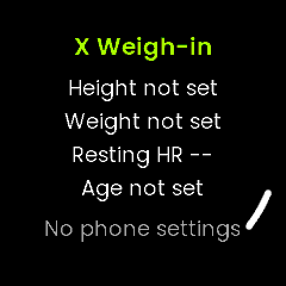
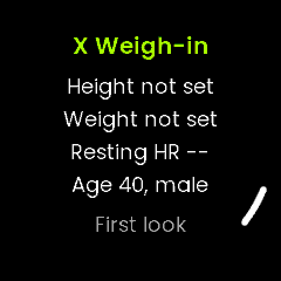
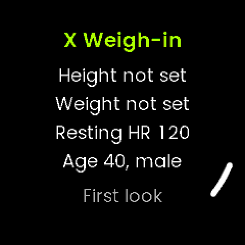

The simulator, left to right: with no phone settings, with settings (born
May 1986, male), and a minute later with the resting HR. The mock kernel leaves
height and weight at 0, so they show as not set.

### W0 verified (12 October 2026)

- **Host tests:** 13 pass, covering:
  - the age at birthday and year boundaries, with month 0, unset, future and
    over 120;
  - the clock floor;
  - kg rounding, including 80.7f, which truncation gets wrong, plus NaN,
    infinity and out-of-range values;
  - formatting at 0, 1 and 2 decimals, with small buffers;
  - the sex labels.
- **`validate_app_config.py --check --check-bounds`:** passes (3 fields).
- **Watch target, local compile check:**
  - Ubuntu's `arm-none-eabi-gcc` with Race's syscall stubs, so the result is
    **not installable**. The watch copy comes from CI.
  - `XWeighIn_0.0.0-dev.uapp`, 192,736 bytes. No warnings.
- **Simulator:** builds and runs (`docs/experiments/sim_run.sh`, retired in W2
  with the first look; `capture_screens.sh` replaces it), with and
  without `app_config.json`.
  - The settings are read: "birth 5/1986, sex 2" gives "Age 40, male".
  - The resting HR arrives after one period (60 s).
  - R2 closes the app.

## Gate W0: what Jon tests on the watch

One question: **does the UNA profile's height and weight reach the app, and
how precisely?** Steps:

1. **Install.**
   - On GitHub, Actions, take the newest green **Watch builds** run on the
     branch `claude/x-weighin` and download **watch-apps**.
   - Over USB, create `Apps/XWeighIn/` on the watch and copy
     `XWeighIn_*.uapp` into it.
   - Eject safely, then power-cycle the watch (as for the other apps; see the
     README).
2. **Open X Weigh-in.** Check height and weight against your profile in the UNA
   app.
   - Note exactly what the weight shows, both decimals. For example, 82.30
     means the profile holds tenths.
   - Photograph the screen.
3. **Wait up to two minutes on the screen.** Does "Resting HR" fill in, and
   roughly how long does it take?
4. **The phone settings, over USB.** Copy a file called `app_config.json`
   into `Apps/XWeighIn/`, containing (with your own birth year and month):

   ```json
   {"schema":1,"values":{"birthYear":1986,"birthMonth":5,"sex":2}}
   ```

   Eject, open the app: does it show your age and "male"?
5. **A profile change.**
   - Change your weight in the UNA app's profile and let the watch sync.
   - Open X Weigh-in again: does it show the new weight?
   - If not, power-cycle the watch and try once more, and note which worked.

What the answers decide:
- **If height and weight both arrive:** W1 builds on them as planned.
- **If the weight arrives only in whole kg, or not at all:** the starting weight
  becomes a W2 entry on the watch instead.
- **If the height is missing:** it becomes a phone setting after all, with the
  conflict noted.

### Gate W0, first run (12 October 2026)

Jon installed the CI build (run 92) and his own `app_config.json`. The photo
is in the conversation. The watch showed:

| Row | Watch | Reading |
|---|---|---|
| Height | 182 cm | **The profile's height reaches the app** |
| Weight | 82.00 kg | **The profile's weight reaches the app** |
| Resting HR | 40 | The daily metric arrives (how soon, not yet noted) |
| Age | 40, male | **The phone settings file works on the watch** |
| Status | First look | Nothing missing |

What this settles:
- Height comes from the profile as planned. No phone setting is needed, so the
  height conflict stays resolved the SDK's way.
- W1 can take the starting weight from the profile.
- The layout fits the real display, clear of the BACK (R2) marker.

Still open from the gate:
- **Resolution.** 82.00 cannot tell whole kg from tenths.
- **A profile change (step 5).** Does a new weight show without a power-cycle?
  Both are answered at once by entering a weight with a decimal (82.4, say) in
  the UNA app, syncing, and reopening.
- **The resting HR.** Does 40 match the UNA app's figure for today, and how
  long did it take to appear?

### Gate W0, second run (12 October 2026)

- **A profile change does not reach the watch.** Jon changed his weight in the
  UNA app. After a sync, and again after a power-cycle, the app still showed
  82.00 kg. So the profile weight is a starting value, not a live figure, and
  its resolution can't be tested.
- **The resting HR of 40 matches the UNA app.**
- **Age can't come from the UNA app.** `RequestSystemSettings` has no birth
  date (`CommandMessages.hpp:195-217`), and no other message carries one. Age
  stays a phone setting.

What it changes for W1:
- **The weigh-in log is the source of truth.** The profile weight is used once,
  as the entry's starting value, before the first weigh-in. After that, the
  entry starts from the last logged weight.
- **Asking UNA (optional).** When does the app push profile changes to the
  watch? The drive-root `settings.json` seen in Streak's Gate 0 may show
  whether the new weight reached the watch at all.

**Gate W0: passed.**

### Jon's decision after the gate (12 October 2026)

**A tracker only, for now.** There is no goal and no warning on the rate of
change: the app shows the weekly change without judging it. The goal screen,
its phone settings and any thresholds are dropped from W1 and W2. They can come
back later as phone settings, which an app update adds without losing the
existing values (`Docs/app-config-fields.md` §7.3).

## W1: the log, the trend and the body numbers (12 October 2026)

Jon's decisions for W1:
- the trend: first 10% a day ("I agree"), then, at Gate W1, **20% a day**
  (see "Gate W1" below);
- **if he weighs in more than once a day, the latest counts**. Every weigh-in
  stays in the log.

W1 is the pure core and its host tests. The service and the screen are
unchanged: the first look still shows, and nothing writes a log yet (W2 does).

### The log file

`Apps/XWeighIn/weighins.csv`, a plain CSV that opens in a spreadsheet straight
off the USB drive:

```
date,time,kg
2026-10-12,07:31,82.30
2026-10-13,07:28,82.10
```

- **The date and time are local**, as the watch showed them. The weight is in
  kg with two decimals.
- **Append-only** (`LogStore::append`): a weigh-in is never rewritten. A reset
  mid-write can at worst leave a torn last line, which the reader skips, and
  the next weigh-in starts on a new line.
- **The reader is strict and forgiving**
  (`WeighLog::parseLine`, `LogStore::scan`):
  - a line must be exactly `YYYY-MM-DD,HH:MM,kg`, with 0-2 decimals, a real date
    in 2000-2099, and 0.01-500 kg;
  - the header and blank lines are skipped, and anything else is counted and
    ignored, never fatal;
  - Windows line endings are fine, so a hand edit on a PC still reads.
  - It streams in 256-byte chunks with no heap, so the file's size doesn't
    matter. A year of daily weigh-ins is about 8 KB.
- **The copy:** `Apps/SharedData/HybridX/weighins.csv`, the same content. It
  survives an uninstall, which deletes the app's own folder.
  - `LogStore::reconcile`, run once at start:
    - our own log missing: restore it from the copy (a reinstall);
    - copy missing or a different size: rewrite it from our own log;
    - our own log always wins when it exists.
  - **To clear the history by hand, delete both files.**
  - A copy streams into `<file>.tmp`, removes the old file, then renames,
    because FatFs rename refuses an existing destination.

### The trend (`Trend`)

- **One weight per local day, the latest that day.** A later weigh-in the same
  day undoes that day and redoes it. So a mistyped entry is fixed by weighing
  again: the sample log below has a 92.80 corrected to 82.80 a minute later,
  and the trend never sees the 92.80.
- **Each day the trend moves 20% of the way to that day's weight,**
  `t += (w - t) × 20%`: an exponential moving average, the method of J. Walker's
  *The Hacker's Diet*, which uses 10%. The first weigh-in starts it.
  - The share is `kTrendPercent` in `Trend.hpp`. `Trend(percent)` and
    `trend_csv <log> <percent>` take another, to compare.
  - It is held in fixed point at 1/10 000 kg, so the watch and the host agree
    exactly.
- **Missed days take a straight line** between the weigh-ins either side, and
  the trend steps through each one. A week off neither freezes the trend nor
  makes it jump, and weekly weighing works. A test checks that alternate-day
  weigh-ins on a slope give the same trend as daily ones.
- **An entry dated before the last day** (the clock went back) is skipped and
  counted. It stays in the log.
- **The weekly change** is the trend at the last day minus the trend 7 days
  before. It is shown once the log spans 7 days, as a plain signed number
  ("-0.4"), without judgement.
- **The last 90 days** of each day's weight and trend are kept in a fixed ring
  (1 KB), for the graph (W2) and the glance (W3).

**What the smoothing does, on a sample log**
(`docs/screens/w1-trend-sample.png`):

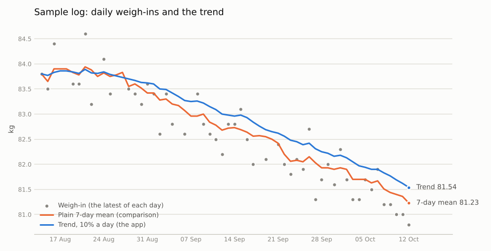

- **The sample** (`make_log`, seed 1) is not real data: 60 days, a built-in loss
  of 0.35 kg a week from 84 kg, day-to-day swings, about one missed day in eight,
  and the one typo.
- **Its table views** are `docs/experiments/w1-trend-sample.csv` (20%) and
  `w1-trend-sample-10.csv` (10%).
- **Both trends ride over the single-day jumps** (84.4, 84.6, 82.2).
- **The price of smoothing is lag.** On a steady change the trend runs about
  (1 − p) / p days behind: 9 days at 10%, 4 days at 20%.
  - Here the built-in weight on the last day is 81.05 kg. The 20% trend says
    81.23 and the 10% one 81.54; that day's reading was 80.80.
  - The trend is "where you are heading", not today's weight.
  - The weekly change reads the rate: -0.47 kg at 20% and -0.40 at 10%,
    against the built-in -0.35.

### The body numbers (`BodyMetrics`)

Both use integers only, and both take the trend weight, which W2 will show.
- **BMI:** kg / m², to 0.1. The height comes from the UNA profile; a height
  outside 50-272 cm counts as not set.
- **Resting energy (BMR):** the Mifflin-St Jeor equation (Mifflin MD, St Jeor
  ST et al., *Am J Clin Nutr* 1990;51:241-7):
  - men: `10 × kg + 6.25 × cm − 5 × age + 5`;
  - women: `10 × kg + 6.25 × cm − 5 × age − 161`;
  - rounded to the nearest kcal.
  - It needs the phone settings' age and sex. If any input is unset it gives 0,
    which the screens show as not set.
- **Check:** 82 kg, 182 cm, 40 years gives BMI 24.8, and BMR 1763 kcal (male)
  or 1597 (female).

### Tools (`Tests/Host`, built with the tests)

- `make_log <out.csv> [days] [seed]` writes the sample log. It will also be W2's
  simulator fixture.
- `trend_csv <weighins.csv>` prints date, weight, trend and 7-day mean from the
  app's own parser and trend, plus the summary the app would show. It works on
  a real log copied off the watch.
- `docs/experiments/trend_chart.py <trend.csv> <out.png>` draws the chart
  above. It needs matplotlib.

### W1 verified (12 October 2026)

- **Host tests: 66 pass** in 12 suites, with no warnings under
  `-Wall -Wextra -Wpedantic` (after the Gate W1 change to 20%).
  - The new suites: Calendar 4, WeighLog 8, LogStore 17, Trend 16, BMI 2, BMR 2,
    FormatChange 4.
  - LogStore runs against Streak's in-memory tree (`support/TreeFileSystem`,
    copied), with FatFs's rename rule. It covers:
    - the header;
    - torn lines;
    - a 500-entry scan across chunk boundaries;
    - restore and refresh;
    - an unreachable SharedData.
  - The expected trend values were worked out separately in Python with the
    same fixed-point rule.
- **Watch target compile check** (Ubuntu toolchain with stubs, not installable):
  the new core compiles into the service with no warnings. The `.uapp`
  (192,752 bytes) hardly grows, because nothing calls the core until W2.
- **Simulator:** builds and runs; the first look is unchanged.
- **Sample:** 52 weigh-ins over 60 days, read back with 0 lines rejected.

## Gate W1: what Jon decided (12 October 2026)

1. **The trend: more responsive**, "just enough to smooth out anomalies".
   - The share was chosen by measurement, not by eye: 20 sample logs (`make_log`
     seeds 1-20, 60 days each), each trend compared day by day with the
     sample's built-in weight, ignoring the first 10 days.

     | Share | Mean distance from the built-in weight | Largest one-day move | Wobble (s.d. of daily change) |
     |---|---|---|---|
     | 10% | 0.47 kg | 0.13 kg | 0.04 kg |
     | 15% | 0.33 kg | 0.17 kg | 0.06 kg |
     | **20%** | **0.26 kg** | **0.23 kg** | **0.08 kg** |
     | 25% | 0.22 kg | 0.29 kg | 0.10 kg |
     | 30% | 0.20 kg | 0.35 kg | 0.13 kg |

   - **20%** roughly halves the 10% trend's lag, and a one-day anomaly still
     moves the trend by only a fifth of its size. Past 20% the accuracy gain is
     small and the wobble keeps growing.
   - `kTrendPercent = 20`. The tests are updated, and a new one keeps 10% and
     100% (no smoothing) as references.
2. **The file layout** `date,time,kg`, in local time, is fine for the data
   needed.

**Gate W1: passed.** Next, W2: the weigh-in screen, the summary, the trend
graph and history.

## W2: the screens (12 October 2026)

W2 makes the app usable. W0's first-look screen and its resting-HR sensor are
gone; the Body page now shows the profile and the settings.

### The buttons and pages

Buttons as labelled on the watch: **UP** (L1), **DOWN** (L2), **SELECT** (R1),
**BACK** (R2).

| Screen | Shows | UP / DOWN | SELECT | BACK |
|---|---|---|---|---|
| **Home** | The trend, large (the headline); the weekly change; "Last 81.5, today" | Pages | Weigh in | Leave |
| **Graph** | The last 30 days: the trend line, a dot per weigh-in, the scale, the dates | Pages | Weigh in | Leave |
| **Recent** | The last 5 days weighed, newest first | Pages | Weigh in | Leave |
| **Body** | BMI, resting kcal (BMR), height, age and sex, and what is missing | Pages | Weigh in | Leave |
| **Weigh in** | The value, large, starting from the last weigh-in | ±0.1 kg; hold to repeat | Save | Cancel |
| **Saved** | "Saved 81.8 kg", the new trend and weekly change; or "Not saved" and why | Home | Home | Home |

- **Paging:** UP and DOWN cycle Home → Graph → Recent → Body and round again. A
  row of four dots shows the page.
- **The entry starts** from the last logged weight. With no log it starts from
  the UNA profile's weight, else 70.0. The hint says which: "Last 81.5, today",
  "From your UNA profile" or "UP and DOWN to set".
- **Hold to repeat** (`HoldRepeat`): a tap is one step. A hold repeats after
  0.6 s, every 200 ms at first, quickening to 50 ms. It is the SDK Timer
  example's method; the watch sends press, release and click codes, and long
  press is derived from them. A click that ends a repeating hold is not an
  extra step.
- **Saving:** the service files the weigh-in under the local date and time
  (`localtime_r`, as Streak does) and appends it to both files.
  - It refuses with "The clock is not set. Sync with the UNA app." rather than
    file it under 1970.
  - The Saved screen returns to Home after 3 s, or at any button.
- **Missing values** read as "--" or "not set", and the Body page names the
  first missing thing:
  - "Height: the UNA profile";
  - "Age, sex: app_config.json".

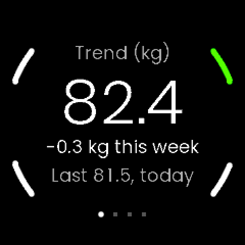 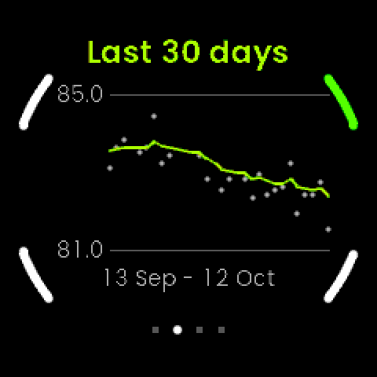
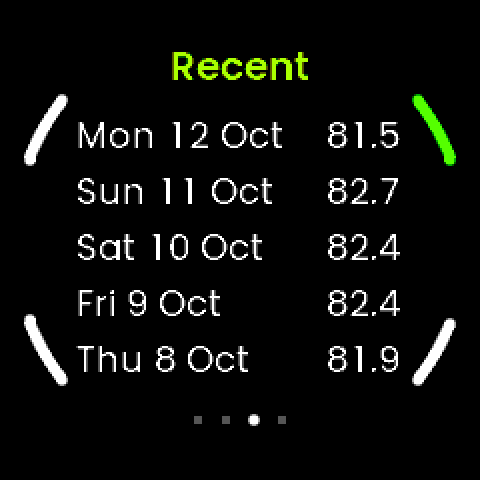 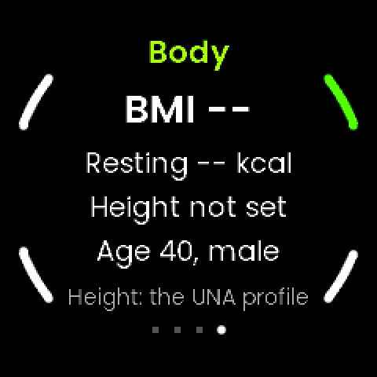
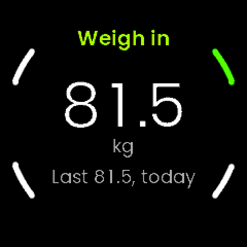 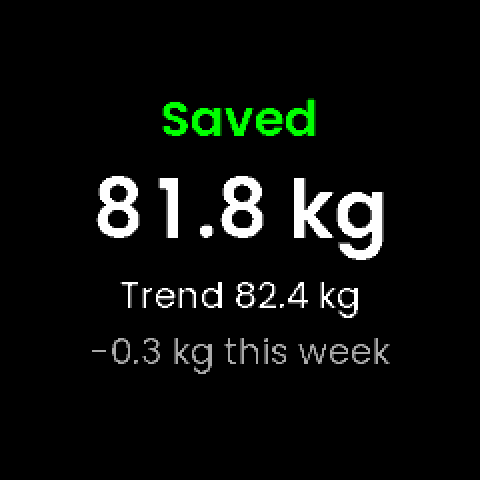
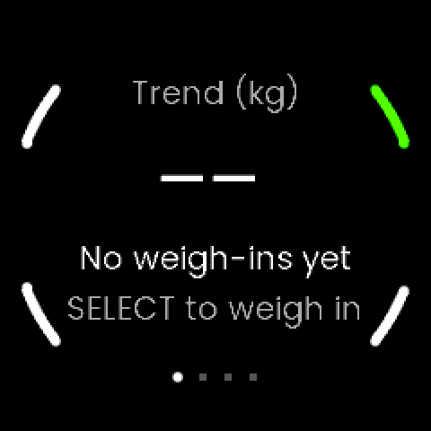 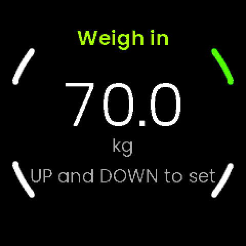

These are simulator shots. The mock kernel gives no profile height or weight,
so the Body page shows "Height not set" and the empty run starts at 70.0.

### How it is built

- **Core, header-only where the GUI uses it, host-tested:**
  - `WeighEntry`: the start value, steps clamped to 1.0-500.0, and
    `HoldRepeat`. Time is injected and deltas are unsigned, so the wrapping ms
    clock is safe.
  - `GraphScale`: the range from the data, padded 0.2 kg, at least 2 kg,
    snapped to 0.5 kg, and the pixel mapping.
  - `DateText`: "Mon 12 Oct", "12 Oct", "today", "yesterday", "3 days ago".
  - `Window`: the last 30 days packed as `uint16` weights and trends, plus
    `recentDays`.
- **Service** (`Libs/App/Sources/Service.cpp`):
  - at start: settings, then `LogStore::reconcile`, then a scan of
    `weighins.csv` into a static `Trend`;
  - when the screen opens: the profile, then `HomeState` and `GraphData`;
  - on `SAVE_WEIGHIN`: `appendBoth`, the trend fed incrementally, then
    `SaveResult`, `HomeState` and `GraphData`.
  - Every message is `static_assert`ed to fit the kernel's 256-byte pool block
    (`una-sdk/Docs/writing-a-clockface.md:310-318`). `GraphData` is about 130 B.
- **GUI:** `Screen` and `ScreenManager` after the SDK's RunLVGL: the next screen
  is built, then the old one freed, on the next LVGL pass.
  - Six screens, in `Screens.hpp`, `Screen.cpp`, `PageScreens.cpp` and
    `EntryScreens.cpp`.
  - Fonts: Waypoint's, plus Poppins Light 60 (digits) and Regular 14, copied
    from HybridX Run. SemiBold 30 is dropped as unused.
- **Layout:** text is kept inside the round display and clear of the four
  button marks. The graph's plot starts at x = 70 with its scale labels beside
  it, and the Recent columns end at x = 200, clear of BACK.

### W2 verified (12 October 2026)

- **Host tests: 93 pass**, with no warnings. The new suites: StartValue 2,
  StepEntry 1, HoldRepeat 8, DateText 4, Window 5, GraphScale 7.
- **Watch target compile check** (Ubuntu toolchain with stubs, not installable):
  no warnings. `XWeighIn_0.0.0-dev.uapp` is 236,148 bytes.
- **Simulator** (`docs/experiments/capture_screens.sh`): every screen captured.
  - The 40-day sample log (`make_log … 40 3 <today>`) reads with 0 lines rejected.
  - A weigh-in 0.3 kg up saved `2026-10-12,13:13,81.80` to
    `Software/Output/weighins.csv`, and the SharedData copy came out identical
    (36 lines).
  - On the first run, `reconcile` created the copy from the sample.
  - LVGL's pool peaked at 58% of about 37 KB (on the Recent page).
- Checked by eye against the round display: nothing clipped and nothing under a
  button mark, after moving the graph's labels and the Recent columns in.

## Gate W2: what Jon tests on the watch

1. **Install** the CI build, as for W0: copy `XWeighIn_*.uapp` into
   `Apps/XWeighIn/` over USB, eject, power-cycle. Keep `app_config.json`.
2. **Weigh in every morning for a week.** Each time:
   - SELECT, set the weight with UP and DOWN, then SELECT again;
   - once, **hold** UP or DOWN: it should start repeating after about half a
     second and speed up;
   - once, weigh in **twice the same day**: the second should replace the first
     on Home ("Last …") and in the trend.
3. **Look at the pages** as the week fills: Graph (dots and the trend line),
   Recent, Body (BMI and resting kcal, with your height and age).
4. **Over USB at the end of the week:**
   - `Apps/XWeighIn/weighins.csv` opens in a spreadsheet, one line per weigh-in;
   - `Apps/SharedData/HybridX/weighins.csv` is the same.
   This confirms the two things W1 relied on that the watch had not yet shown:
   appending by seek, and writing the SharedData folder.
5. **Optional:** uninstall the app, then reinstall it and copy
   `app_config.json` back. The history should come back from the SharedData
   copy.

Anything that reads wrong (a clipped word, a slow button, a number that looks
off), a photo is ideal.

### Gate W2, day 1 (12 October 2026)

Jon sent `Apps/SharedData/HybridX/weighins.csv` from the watch, with a photo of
the folder listing:

```
date,time,kg
2026-10-12,15:30,82.40
```

- **The SharedData copy works on the watch.** The app wrote the file next to
  Streak's `streak.json`, byte for byte as `formatEntry` writes it: a header
  and one weigh-in, 36 bytes, as the listing shows.
- **The entry is in local time and the file stamp is not.** The listing shows
  the file modified at 14:30 and the entry says 15:30. That is the BST offset
  (+60 min, as Streak's probe read the clock: Streak NOTES, "Gate 0: first run
  on Jon's watch"). The likely explanation: the entry uses `localtime_r`, as
  planned, and the file system stamps files in UTC. Jon to confirm he weighed
  in at about 15:30.
- **Still to show:** appending to a file that already exists (the second
  weigh-in on), and that `Apps/XWeighIn/weighins.csv` matches the copy.
- In the same session Jon sent `Apps/SharedData/stride.json`. It is not ours:
  the SDK's outdoor stride calibrator writes it (`StrideLut::kDefaultPath`),
  as Streak NOTES E.3 records.

### Gate W2, the second weigh-in (12 October 2026)

Jon reports that the second reading works, and that the app's own copy
(`Apps/XWeighIn/weighins.csv`) does too. **Appending to a file that already
exists works on the watch**, so both platform behaviours W1 relied on are now
shown. The gate itself, a week of weigh-ins, carries on. Still open from day 1:
whether 15:30 was the right time.

## W3: the glance (12 October 2026)

The glance shows the trend on the watch's glances screen, without opening the
app. It is a second `.uapp`, `XWeighInGlance`, built as HybridX Streak's glance
is. Streak's has drawn on Jon's watch since its S4.

### What it shows

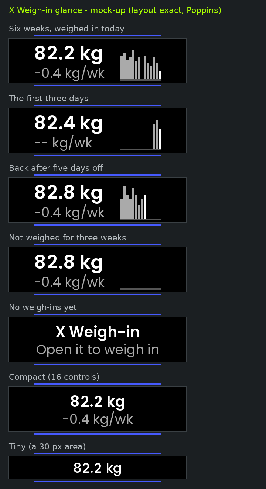

- **Everything keeps to the middle 172 px** (x = 34 to 206), in line with the
  glances list's separator lines. The list's scroll arc covers both edges
  (Gate W3, first look, below).
- **On the left, the trend** in SemiBold 25, `82.2 kg`, as on Home. Under it,
  the weekly change, `-0.4 kg/wk` (`-- kg/wk` until the log spans a week).
  - The words column is 113 px: `123.4 kg` is 113 px in SemiBold 25 and
    `-10.4 kg/wk` 106 px in Regular 18. Home's `-0.4 kg this week` (150 px)
    would not fit.
- **On the right, 14 bars,** one per day, ending today: 3 px wide with a 1 px
  gap, 55 px in all.
  - Each bar is that day's weigh-in, with heights on the 14 days' own scale
    (`GraphScale`: at least 2 kg tall, so a 0.2 kg wobble stays small).
  - A missed day is a gap, over a dark grey baseline.
  - The newest bar is white and the rest are grey. Bars are neutral: the app is
    a tracker.
  - Days after the last weigh-in are empty, so a week off shows. With the clock
    not set, the bars end at the log's last day.
- **No log yet:** "X Weigh-in" / "No weigh-ins yet" (it was "Open it to weigh in" until W5).
- **Fallbacks,** for an area or budget no watch has reported yet:
  - Compact (fewer than 17 controls, or a smaller area): the two lines
    centred;
  - Tiny (under 48 px tall): `82.2 kg` alone.
- **The label** on the glances screen is "X Weigh-in" (`APP_USER_NAME`).

The picture is a mock-up drawn from the real code's output
(`build-tests/glance_preview` → `docs/experiments/glance_preview.py`), in the
SDK's Poppins. The PC simulator cannot run glances (Streak NOTES S0), so the
watch is the first place it is seen for real.

### How it is built

- **What it reads:** `../SharedData/HybridX/weighins.csv`, the copy of the log
  the app keeps identical to its own (W1).
  - That folder is the one place outside its own a glance can open (Streak
    NOTES, Gate 0, final look). Gate W2 showed the copy is written on the watch.
  - The file goes through the same `LogStore::scan` and `Trend` as the app,
    so the glance and Home always agree.
  - **It never writes.** The app is the single writer, so there is nothing new
    on the watch.
- **When:** on `EVENT_GLANCE_START`, it asks for the area
  (`RequestGlanceConfig`), reads the log and builds the form.
  - It sends the form on the next `EVENT_GLANCE_TICK`.
  - It exits on `EVENT_GLANCE_STOP`, so every look reads the log afresh.
  - This is the SDK's GlanceSteps pattern, as Streak's
    (`Docs/service-lifecycle.md` 3.3).
- **Code** (`Software/Libs/Glance`, a third library beside Core and App):
  - `GlanceView`: the headline and the 14 days, from the trend.
  - `GlanceLayout`: the controls, as specs, for the area and budget the watch
    reports.
  - `Service`: Streak's glance service, trimmed. The trend, view and layout
    are static, off the 10 KB stack and off the heap.
  - The glance and the app each have their own `Service.hpp`, so `libs.cmake`
    now lists Core, App and Glance separately, as Streak's does.
- **Shapes:** text and filled rectangles only.
  - Line controls do not draw on the watch (Streak NOTES S4.3), and the layout
    has no way to make one.
  - Words are plain ASCII in 18-25 point faces.
- **Budget:** 2 texts, the baseline and up to 14 bars, so **17 controls** of
  the 32 Jon's watch allows.
  - The SDK's `Form` reserves 16, so it grows once while the glance is built.
    That is once per look, not in a loop. Streak's full layout does the same.
- **Project:** `Software/Apps/XWeighInGlance-CMake`.
  - `APP_TYPE Glance`, with no GUI, no icons and no manifest.
  - `APP_ID 5543E86906F4A1B3`: a development ID, the first 16 hex of
    md5("XWeighInGlance").
  - It writes to `Output/Glance/`, so `Output/` keeps one `.uapp`.
  - CI builds it and puts `XWeighInGlance_*.uapp` in `watch-apps`.
- **Not on the store,** like Streak's. How one store listing installs two
  `.uapp`s is still a question for UNA (Streak PLAN, UNA question 4).

### W3 verified (12 October 2026)

- **Host tests: 113 pass**, with no warnings. The new suites:
  - **GlanceView, 11 tests:**
    - the bars end today, or at the last day without the clock;
    - missed days, a stale log and the same-day rule;
    - reading the SharedData copy from the glance's own folder, with the app's
      log out of reach, and no copy.
  - **GlanceLayout, 9 tests,** Streak's checks:
    - every control lies inside the area, and the budget is kept, for 9 views ×
      8 areas × 6 budgets;
    - texts are ASCII and fit their boxes in the real Poppins widths
      (SemiBold 25 added to `support/GlanceFontWidths.hpp` from the SDK's
      tables);
    - the bars stand on the baseline, in day order and clear of the words, and
      a missed day leaves a gap.
  - A check of the checks: narrowing the words column to 110 px makes the
    width test fail on `-0.4 kg/week` (117 px).
- **Watch target compile check** (Ubuntu toolchain with stubs, not
  installable):
  - `XWeighInGlance_0.0.0-dev.uapp` is 26,508 bytes;
  - the app is unchanged at 236,148 bytes;
  - no warnings in our files.
- **The app after the `libs.cmake` split:**
  - the simulator rebuilds;
  - `capture_screens.sh` runs as before;
  - a weigh-in reaches both files, identical.
- **The mock-up,** checked by eye: the words are clear of the bars and nothing
  is clipped.

## Gate W3: what Jon tests on the watch

1. **Install** the glance from the same CI run's `watch-apps`:
   - create a new folder on the watch, `Apps/XWeighInGlance/`;
   - copy `XWeighInGlance_*.uapp` into it;
   - eject safely, and power-cycle the watch.
   Leave `Apps/XWeighIn/` as it is.
2. **Open the glances screen.** "X Weigh-in" should show your trend, the weekly
   change and a bar for each weigh-in so far. A photo, please.
3. **Weigh in with the app, then look at the glance again.** Today's bar and the
   trend should have moved.
4. **Anything off** (a clipped word, a missing bar, the wrong numbers), a
   photo is ideal.

### Gate W3, first look (12 October 2026)

Jon installed the CI build (run 103) and sent a photo of the glances list.

**What worked:**
- The glance ran, read the SharedData copy and showed his trend, `82.2 kg`
  (two weigh-ins on 12 October; the latest counts).
- The weekly change line was there, and so were the baseline and that day's
  white bar.

**What was wrong:** the text did not display properly and the content was not
aligned with the list. The photo shows why:
- The glance gets the display's full width, 240 px. But the glances list draws
  its separator lines (above and below each glance) only from about x = 34 to
  206, and the titles of the other entries ("Streak", "Notifications") are
  centred between them.
- The list also draws a scroll arc over the left and right edges, about 10 px
  thick, just inside the bezel.
- The layout used x = 4 to 236. So `82.2 kg` started at the bezel, the `--` of
  `-- kg/week` sat under the left arc and looked broken, and the bars ended
  at the right bezel.

These positions are measured from the photo against the 240 px display. They
are approximate, and nothing in the SDK documents them.

**Fix:** every layout keeps to the middle 172 px (`kSafeW` in
`GlanceLayout.cpp`).
- The full layout puts the words at the left separator and ends the bars at
  the right one.
- To fit the band:
  - the bars are 3 px wide with a 1 px gap;
  - the words column is 113 px;
  - the change reads `-0.4 kg/wk`.
- Compact and tiny centre their text within the same band.
- **Guards:**
  - `GlanceLayoutTest` now fails if any control of any layout, for any area
    and budget, leaves the middle 172 px of a 240 px area;
  - a trial run with the old full-width band failed it.
- **Mock-up:** `glance_preview.py` now draws the list's separators above and
  below each panel, so alignment shows before the watch.
- **Streak's glance** uses the same 240 px from x = 4 (its mountain) and may
  have the same overlap. Not changed here; Streak's own phase decides.
- **Verified:**
  - 113 host tests pass;
  - the glance compiles for the watch (26,524 bytes, a compile check with stubs);
  - the mock-up was checked by eye against the separators.
- **Jon to check:** the glance on the watch again, from the next CI build.

### Gate W3, second look (12 October 2026): the layout is right

Jon installed CI run 111 and sent a photo of the glances list. He says it looks
good.
- `82.2 kg` and `-- kg/wk` start at the left separator, clear of the scroll arc.
- The baseline and the day's white bar end at the right separator.
- Every character draws.

**Still to see over the coming days:**
- the bars filling in, one a day;
- the weekly change replacing `--` once the log spans a week.

The glance needs no change for that, so W3 is done unless those show a fault.

### Jon's decisions after Gate W3 (12 October 2026)

- **The time is fine.** The 15:30 entry against the 14:30 file stamp is BST
  against UTC, as expected.
- **W4, the sweat-rate test, waits** until after the first release of this
  package.

## W5: the first store release (12 October 2026)

Jon wants this package on the store before the sweat-rate test. W5 gets
everything ready, so that the release itself needs only:
- the App ID from the portal;
- Gate W2's week passing;
- the tag `weighin-v1.0.0`.

`SUBMISSION.md` holds the steps for the day and the store text.

### What the package holds

`Utilities/pack-store-zip.sh`, a copy of HybridX Race's script, builds
`Output/XWeighIn-<version>.zip`:
- `XWeighIn_<version>.uapp`;
- `app-manifest.json`, with `binary` and `appVersion` taken from the `.uapp`;
- `icon.png` (the 60×60 icon);
- `previews/`: five 480×480 simulator screens (Home, Graph, Recent, Weigh in,
  Saved), from `capture_screens.sh`. Body is left out because the simulator
  has no profile height.

The script refuses:
- more than one `.uapp` in `Output/`;
- a version that is not the tag's (`--expect-version`);
- App IDs that differ between the app's CMakeLists, the manifest and the
  simulator;
- on a release, the development ID `6E1B68E38137C089`.

Before it zips, it runs both SDK checks:
- `min_kernel_version.py --stamp/--check`;
- `validate_app_config.py`, against `AppConfigFields`.

CI runs it on every push, after the watch builds, as **weighin-store-zip**.
- On a `weighin-v*` tag it passes `--expect-version` itself.
- Otherwise it is a dry run with the dev build.

**The glance was first left out of the package**, because one listing installs
one `.uapp` (HybridX Streak NOTES S5.1). Jon looked into it on 13 October, and
it needs its own listing. See "The glance's own listing" below.

### Manifest changes

- **`requiredHardware` is now `[]`.** HR was there for W0's resting-HR first
  look, and W2 removed the sensor. Streak's is `[]` too, as in the SDK example
  (`Docs/app-config-json.md` L73). Leaving HR there could hide the app from a
  watch for a sensor it never opens.
- **The description** now says what the app does: kg, the trend, the week's
  change, the graph, BMI and resting kcal, and that weigh-ins stay on the
  watch.
- **The birth year's help text** no longer says "later": resting kcal is on the
  Body page since W2. Only the text changed, so the user's value is kept
  (`Docs/app-config-fields.md` §7.3).

### W5 verified (12 October 2026)

- **`pack-store-zip.sh` on the local dev build** (stubs, so a dry run):
  - it stages, stamps, validates and zips 9 entries: the `.uapp`, the manifest,
    `icon.png`, `previews/` and its five PNGs;
  - `--expect-version 1.0.0` against the 0.0.0-dev binary is refused;
  - a different App ID in the simulator's CMakeLists is refused;
  - a `XWeighIn_1.0.0.uapp` with the development ID and `--expect-version 1.0.0`
    is refused.
- **`validate_app_config.py`:** passes (3 fields).
- **Not rebuilt:** the source is unchanged, so the host tests (113) and both
  builds still stand from W3.

### The glance's own listing (13 October 2026)

**Jon's decision:** the glance goes on the store as a second listing, **X
Weigh-in Glance**, dependent on the app. Expecting users to install over USB is
not realistic.

**What was added:**
- **`Resources/Glance/app-manifest.json`:**
  - `type ["glance"]`, `name "X Weigh-in Glance"`, `requiredHardware []`;
  - no phone settings;
  - its development ID `5543E86906F4A1B3`;
  - a description saying it needs the app.
  None of the SDK's glance examples ships a manifest, so this follows
  `Docs/app-config-json.md`: the type list allows `glance`.
  `validate_app_config.py` passes it.
- **Previews:** three 480×480 PNGs in `Resources/Glance/previews/`.
  - They are made by `glance_preview.py --store` from the real layout code.
  - Each shows the glance at the middle of a round screen, between the
    list's separators, as on the watch (Gate W3).
  - The simulator cannot run glances, so these are drawn, not captured.
- **The icon:** the app's scale icon, `Resources/icon_60x60.png`.
- **`pack-store-zip.sh --glance`:**
  - packages `Output/Glance/XWeighInGlance_<ver>.uapp` into
    `Output/Glance/XWeighInGlance-<ver>.zip`;
  - makes the same version and App ID checks: the glance's CMakeLists against
    its manifest, and its own development ID refused on a release;
  - checks with the SDK's validator that it has no settings.
- **CI** runs both. `weighin-store-zip` holds `XWeighIn-<ver>.zip` and
  `Glance/XWeighInGlance-<ver>.zip`. The one tag `weighin-v1.0.0` versions both.
- **The glance's empty state** was "X Weigh-in" / "Open it to weigh in". It is
  now "X Weigh-in" / "No weigh-ins yet", which is also true for someone who
  installed the glance without the app.

**Verified** (13 October 2026):
- 113 host tests pass, and the glance compiles for the watch.
- `pack-store-zip.sh --glance` dry run: 7 entries (the `.uapp`, the manifest,
  `icon.png`, `previews/` and its three PNGs).
- The glance package refuses:
  - `--expect-version 1.0.0` against the dev binary;
  - its development ID on a `1.0.0` binary;
  - an ID in the manifest that differs from its CMakeLists.
- The app package is unchanged and still passes.

**Still unknown, until the release:**
- whether the portal accepts a glance-only listing;
- how the phone app shows it.

Jon found that a separate listing is the route; the first upload will show it.

### The portal's App IDs (13 October 2026)

Jon created both listings on apps.unawatch.com:

| Listing | App ID | Development ID it replaces |
|---|---|---|
| X Weigh-in | `E60C06AC406AE6B1` | `6E1B68E38137C089` |
| X Weigh-in Glance | `63F628D5251835AD` | `5543E86906F4A1B3` |

- **Where the IDs now are:**
  - the app's ID: `XWeighIn-CMake/CMakeLists.txt`, `Resources/app-manifest.json`
    and the simulator's `CMakeLists.txt`;
  - the glance's ID: `XWeighInGlance-CMake/CMakeLists.txt` and
    `Resources/Glance/app-manifest.json`.
- **Verified:**
  - both rebuilt `.uapp`s carry their new ID;
  - both dry-run packages report "App ID … matches";
  - the simulator rebuilds.
- `pack-store-zip.sh` still names the development IDs, so it refuses them if
  they ever come back.

**What is left for 1.0.0:**
- Gate W2's week passing;
- the merge (PR #27);
- the tag `weighin-v1.0.0`;
- Jon's uploads (`SUBMISSION.md`, from step 3).

### Tagged 1.0.0 (13 October 2026)

- **At Jon's request,** the release commit (c2e21ba, "X Weigh-in 1.0.0") is
  to be tagged `weighin-v1.0.0`.
  - **This session cannot push tags.** The git proxy drops the push ("unexpected
    disconnect"), while branch pushes work. The GitHub tools here cannot make a
    tag either.
  - So Jon creates it on GitHub as a release, which pushes the tag and starts
    *Watch builds* (SUBMISSION.md, "Making the tag on GitHub").
  - That is before Gate W2's week has finished; Jon had two days of weigh-ins
    on the watch.
  - PR #27 merged the branch only up to the glance fix (026be31). The W5
    commits, the packages and the App IDs, are on `claude/x-weighin`, so the
    tag goes there.
- **CHANGELOG:** "Unreleased" became 1.0.0.
- **CI on the tag** builds `XWeighIn_1.0.0.uapp` and
  `XWeighInGlance_1.0.0.uapp`, and packs both with `--expect-version 1.0.0`.
  That refuses a wrong version or a development ID.
- **The zips** are in `weighin-store-zip`: `XWeighIn-1.0.0.zip` and
  `Glance/XWeighInGlance-1.0.0.zip`.

### Released (13 October 2026)

- **The tag:** Jon made `weighin-v1.0.0` on GitHub as a release, on bcf0e12
  (the release commit plus a docs wording fix).
- **The build:** *Watch builds* run 122 on the tag is green. With
  `--expect-version 1.0.0`, the packager checked both zips for the version and
  the portal App IDs before writing them.
- **Jon:** "All built and installed and looks good."
- **Still open:**
  - the rest of Gate W2's week;
  - the Gate W5 checks below, on the store install.

### Store images (13 October 2026)

At Jon's request, `docs/store/` holds two sets of store images, one per
listing. `docs/experiments/store_images.py` makes them, and
`docs/store/README.md` lists them:
- **previews:** the packages' 480×480 screens;
- **mock-ups:** each screen on a drawn watch, 1080×1080;
- **marketing cards:** 1080×1080, four for the app and three for the glance;
- **a banner** for each, 1920×1080.

**What is real:**
- The screens are real: simulator captures for the app, and the real layout
  code's output for the glance.
- The watch is UNA's own render, from the SDK's Figma UI Resource Pack
  (`Docs/Templates/Figma-UI-Kit/`, a zip of 2000×2000 renders with the screen
  transparent). Jon pointed to it.
  - The first version drew a generic watch.
  - The renders are read from `$UNA_SDK`, not copied in.
- Only the backgrounds and the headlines are drawn, and the headlines claim no
  more than SUBMISSION.md's checked store text.

The portal gives no image sizes, so these are common ones.

## Gate W5: what Jon tests (after the store install)

1. **Both install** from the store through the UNA app: X Weigh-in opens, and
   X Weigh-in Glance appears in the glances list with your trend.
2. **The settings screen.** In the UNA app, X Weigh-in's settings show Birth
   year, Birth month and Sex. Set yours there. When you next open the app,
   the Body page shows your age and resting kcal.
3. **The log carries on.** Home shows your trend and history as before. The
   store install either keeps `Apps/XWeighIn/weighins.csv` or restores it from
   the SharedData copy.

## Open, for later phases

- **The `sex` field's encoding** is fixed from here on. Changing a field's type
  later discards the user's value (`Docs/app-config-fields.md` §7.3).

---

## SDK v1.6.0 (14 October 2026)

The SDK released v1.6.0 (structured workouts, GPS speed filter, buzzer pitch, shared `:/Workouts`). Our pin is unchanged (`a7a995a1`); ABI 3 / kernel 1.4.0 at both. What it means for this app, and the plan to move the pin, are in `hybridx-race/docs/NOTES.md`, "Amendment — UNA SDK v1.6.0 reviewed" (5.21-5.24).

**Decision (14 October 2026):** small update to the entry screens (non-circular wheel, hints). See `hybridx-race/docs/NOTES.md` 5.25.
